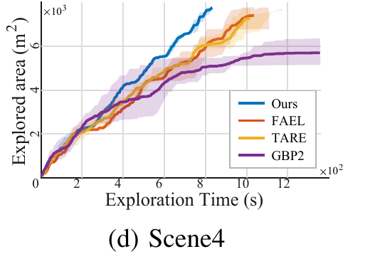
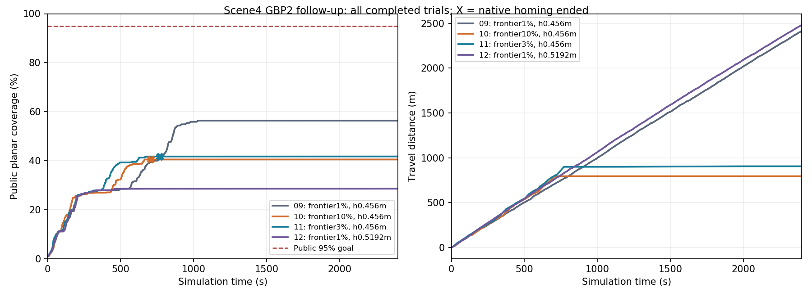
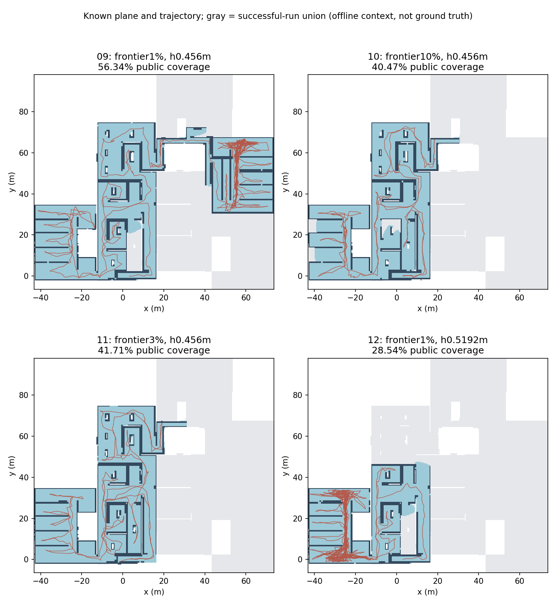

# Scene4 GBP2后续优化与机制验证

本轮新增正式试验限额3次（10/11/12）已用完，三次均未达公共95%，也未提高历史修复09的56.338896%覆盖。按用户限制停止GBP2优化，不再测试或修改算法。当前配置下GBP2存在明显覆盖停滞，不作为Scene4达95%的成功基线。

已恢复历史修复09的可追溯已测试配置（前沿0.01、名义高度0.456m），原生源码及两库仍与09一致；该配置仍明确标为未达95%。全部候选before/after、失败数据和校准依据保留，不将较差候选作为默认性能优化。

本轮承接已阶段性完成的四算法基线，只恢复GBP2。TARE保持已验证原版，FAEL成功数据保留；历史失败、用户中止和原始基线不覆盖。下表包括本阶段全部已完成试验，不能只选最好一次。

## 全部结果与论文对照

| 运行/设置 | 完整观察时间(s) | 原生结束时刻(s) | 最终公共覆盖 | 路程(m) | 公共95% | 原生规划耗时均值(s) |
|---|---:|---:|---:|---:|---|---:|
| 原论文Scene4 GBP2 | >1600，Std为— | 未给精确成功结束 | 未提供本地同口径数值 | >1560，Std为— | 表格不能证明成功 | 0.465 |
| 历史修复09：前沿1%、高度0.456m | 2400.007 | 未原生结束 | 56.3389% | 2413.450 | 未达到 | 1.008015 |
| 10：前沿10%；高度0.456m | 2400.040 | 707.079 | 40.4724% | 794.006 | 未达到 | 0.824011 |
| 11：前沿3%；高度0.456m | 2400.026 | 769.861 | 41.7068% | 905.129 | 未达到 | 0.835254 |
| 12：距地高度校准；前沿1%、高度0.5192m | 2400.036 | 未原生结束 | 28.5350% | 2482.385 | 未达到 | 1.182838 |

观察时间不是未完成试验的探索完成时间。原生返航后继续到既定上限的停车观察包含在总时间内，因此整段平均速度会下降；不能据此说机器人探索阶段的速度下降。原生结束与公共95%分开报告，健康验收通过也不代表探索成功。

长时间原生结束后保持阶段的零指令、实际位移/里程和面积增长另存逐项验证；总路程仍包含仿真中的被动漂移，不把该阶段称为继续探索。公共停止后的短时停车验收与整个保持阶段的漂移也分别解释。

原论文Table I的GBP2时间、距离为下界，标准差为横线；不能仅据此断言崩溃，也不能假设已成功完成。论文IV-A说明统一修改FALCO、2m/s及VLP16；我们未取得作者各基线适配的完整运行配置和逐次记录，停止定义也不能冒称完全相同。[论文v4](https://arxiv.org/html/2412.13664v4)

论文原图补充：Fig.5(d)的GBP2紫色曲线在图示时间窗内停于明显低于另外三种方法的平台。图本身也提供了覆盖停滞的证据；它未提供逐次成功判定或本地同口径95%统计，不据图估填精确成功率或理论完备性结论。原文阴影仅标为上下界。

来源：[原论文PDF的Fig.5(d)](https://arxiv.org/pdf/2412.13664v4#page=6)。未将图像读数冒充作者原始数值。完整相关页、原始PDF及SHA在paper_review保存。

灰色背景是其他成功运行已知平面的离线并集，用来展示遗漏位置；不是可达真值，也从未作为规划输入。

## 实际改变了什么

- 10仅把原生前沿资格比例从0.01提高至上游C++默认0.1；11测试预定中间值0.03。它们与公共95%阈值是不同参数。12以09的1%为对照，仅校准高度。用户随后明确将本轮新增正式试验上限设为3次（10/11/12），取消原计划1.5%及全部复测；旧v1/v2只作历史保存，不能触发继续运行。没有对新结果改名或挑选删除。
- 原生源码、两库均与工程修复09一致，继续使用三维射线体积收益、原生全局回退、采样2000、12m范围、2m/s公共控制、同一Scene4场景定义与公共观察器，以及2400秒上限。每轮独立建立新图。09含先前工程修复，不是未修改的上游原版；10的默认阈值也不等于最初正式01的完整配置。
- 运行时URDF显示雷达相对base_link为0.4557m，轮胎接地点为−0.0635m，因此雷达相对接地面为0.5192m。GBP2输入是sensor帧里程计；原0.456m不能同时当作该输入帧距地高度。高度校准若运行，另列为独立试验；它影响感知高度与部分原生状态转换，不改TF、公共指标或运动上限。
- 新增诊断只读订阅动作、速度指令、实际参数和加载库；公共停止后才保存原生地图，11起还保存原生图。原生图序列化中的is_frontier是保存的收益标记，不能冒充内部活动Vertex::type。

**量程口径：** 运行时URDF的VLP16为16条垂直线、±15°、水平1800采样、10Hz，插件max_range=130m；原生收益max_range、Voxblox积分max_ray_length_m和公共UFOMap max_range均为12m。本文“12m”指有效规划/建图/公共评分上限，不能写成物理仿真LiDAR最大量程12m。物理传感器设置未在本轮改变。审计见sensor_model_audit.json与各运行冻结配置。

## 证据支持的解释

1. **高阈值会提前耗尽合格前沿。** 10在约707.079秒、40.4724%时原生返航；日志为局部连续低收益、全局无合格前沿后调用HOMING，剩余任务预算约2930秒，排除了这次是时间预算耗尽。之后完整观察至2400.040秒仍未增加面积。
2. **低阈值会保留已知平面上的三维残余收益。** 09冻结地图的48次历史选点重查中，未知样本XY投影全部位于公共已知平面，未知样本多数在2m以上。这是最终地图的查询分布，不能当历史收益重建或唯一原因证明。新的原生地图网格诊断不读公共平面；在固定0.456m平地感知高度查询时，09/10分别约81.85%/68.14%的未知样本投影到原生0.1–1.9m高度带内至少含一个已知体素的列。原生追求三维未知体积与公共二维已知面积并不等价。
3. **没有证据支持简单扩大边界、修TF或只改均匀射线。** 其他三种成功运行已知平面都在现有GBP2全局XY边界内；点云帧与sensor里程计在同一world下仅约0.3mm高度差。均匀/非均匀射线冻结查询结果接近。旧03地图的2°垂直采样对照也没有证明单改分辨率可消除残余收益。
4. **仍须区分适配误差与方法启发式。** 地面投影带来量化误差，固定名义高度也需使用正确几何参考；前沿保存、资格过滤、局部贪心与全局回退共同影响遗漏。有限次失败不能证明GBP2在Scene4或这类场景中永远不能完整探索。

上游说明其局部层最大化新映射体积，全局层在局部耗尽时返回保存的高收益位置，并在任务预算或探索结束条件下返航；这解释了为何原生结束条件与本地95%条件可能不同。[GBPlanner2上游说明](https://github.com/ntnu-arl/gbplanner_ros/wiki)

名义平地根状态换算核对：中位根状态换算出的感知高度与独立平地里程计快照之差由约8.40cm缩小到约2.08cm。快照并非逐个根状态同步配对，剩余投影量化误差及各采样/聚类状态仍需分别处理；此功能差异不等于探索性能改进。

本轮证据显示两种失效表现：低阈值保留残余三维收益，局部往返且全局回退受阻；提高至3%/10%后则在约40%覆盖时耗尽合格前沿并返航。几何名义高度校准虽缩小平地参考高度差，本次覆盖仍只有28.5350%，没有解决停滞；单次结果不能证明该校准在所有条件下必然降低性能。原生3D收益、前沿资格和全局回退与二维公共完整覆盖不等价。工程上按当前Scene4适配不足归档；这些有限观测不能证明GBP2在所有此类场景理论上都无法成功，也不能排除尚未核实的适配因素。

## 验收、数据与下一步

离线选点重访核对：以距离至少60秒前轨迹不超过1m为诊断标准，09在1000秒后的208个有效本地最佳路径叶点中，117个靠近旧轨迹（56.25%）；可完整观察随后100秒的196个窗口中，192个面积增长小于1m²。该统计排除最终返航和原生结束后保持；合法全局回溯也可能经过旧轨迹，叶点也不等于截断后的实际执行目标，所以它是回访与停滞的关联证据，不是单独因果证明。完整方法与全部运行见revisit_diagnostics.json。

- `gbp2_default_frontier_20261028_10`：47项协议/数据检查通过；公共95%未达到。原始数据保存在`benchmarks/results/gbp2_default_frontier_20261028_10`，配置和源码指纹在其`preflight`，结果、事件、曲线采样、轨迹、平面图、原生日志、停车验收和原生地图均保留。
- `gbp2_frontier03_20261028_11`：47项协议/数据检查通过；公共95%未达到。原始数据保存在`benchmarks/results/gbp2_frontier03_20261028_11`，配置和源码指纹在其`preflight`，结果、事件、曲线采样、轨迹、平面图、原生日志、停车验收和原生地图均保留。
- `gbp2_sensor_height_20261028_12`：46项协议/数据检查通过；公共95%未达到。原始数据保存在`benchmarks/results/gbp2_sensor_height_20261028_12`，配置和源码指纹在其`preflight`，结果、事件、曲线采样、轨迹、平面图、原生日志、停车验收和原生地图均保留。

不再启动1.5%阈值、复测、地图重放或新源码优化。仅完成离线结果整理、交接及私有备份；保留STGPlanner/TARE/FAEL已成功基线与GBP2未达标对照。今后若用户另行明确恢复，必须先设新的有限次数和停止条件，不能自动扩展本轮限制。

工具说明见`codex/work/gbp2_optimization_20261028/README.md`；Git归档对应`benchmarks/gbp2_optimization_20261028`。诊断和逐项验收在`codex/outputs/gbp2_optimization_20261028`，Git原始证据在`evidence/gbp2-optimization-20261028`。既有四算法预选基线表保留原行，本后续作为独立补充，不用最好一次替换历史基线，不宣称论文五次统计复现。

私有备份验收以`GBP2_OPTIMIZATION_BACKUP_VERIFIED.json`为准；未生成前不宣称远端已验收。
