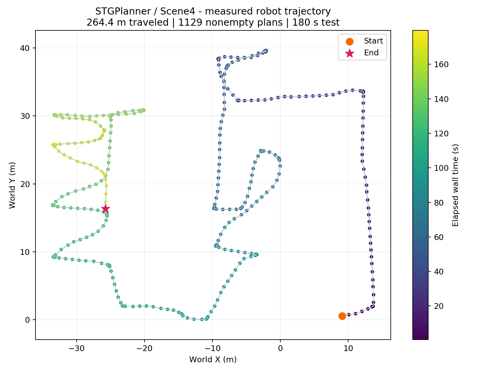
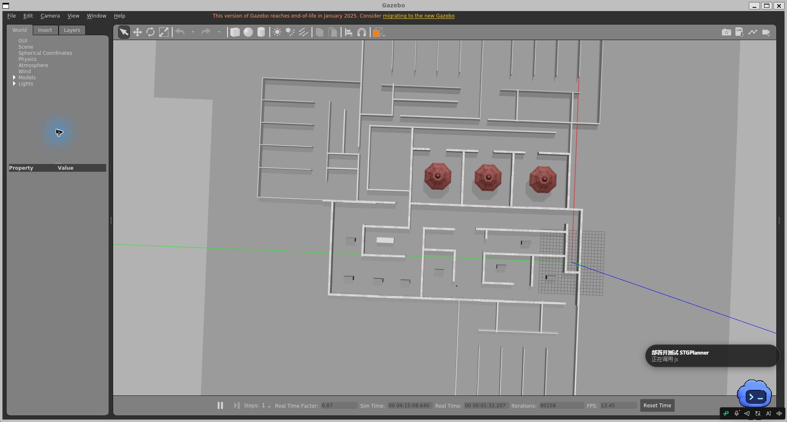
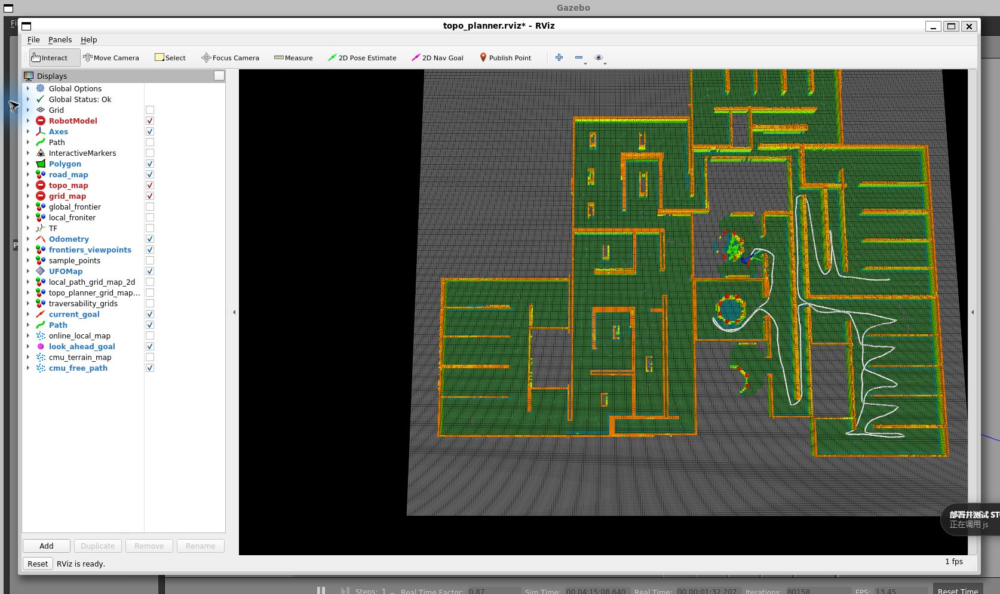
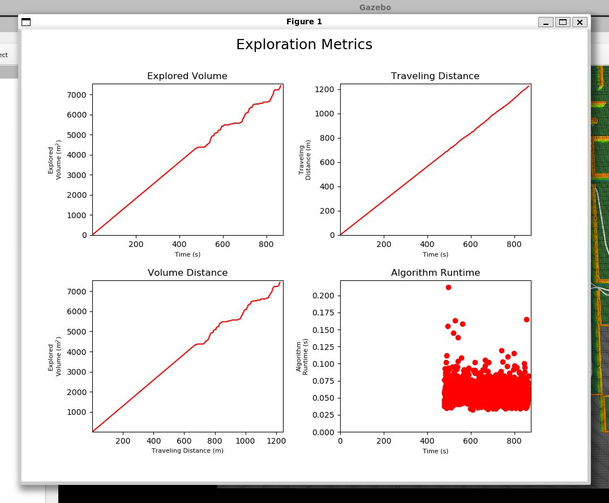
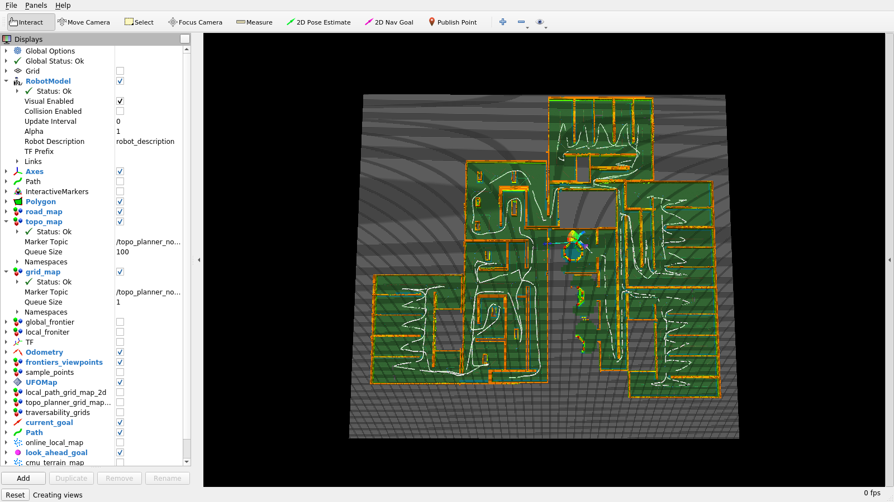
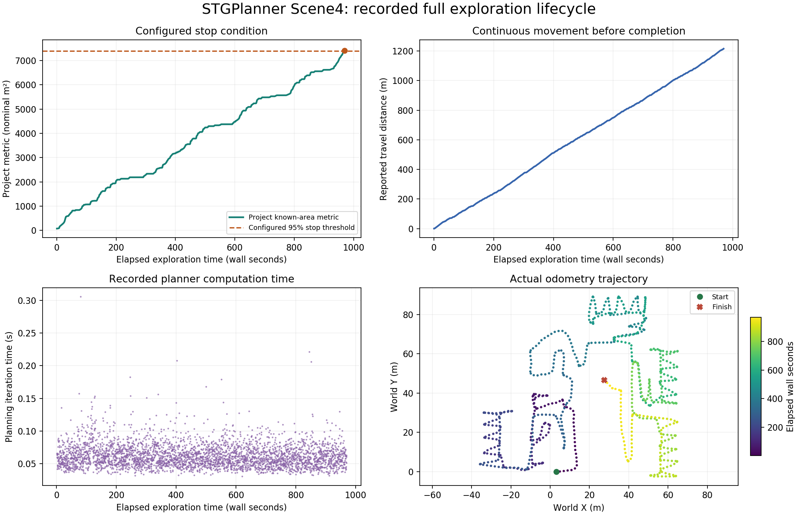
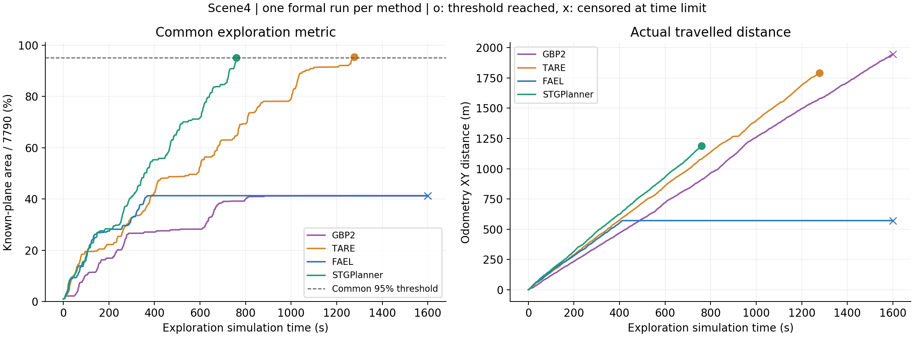
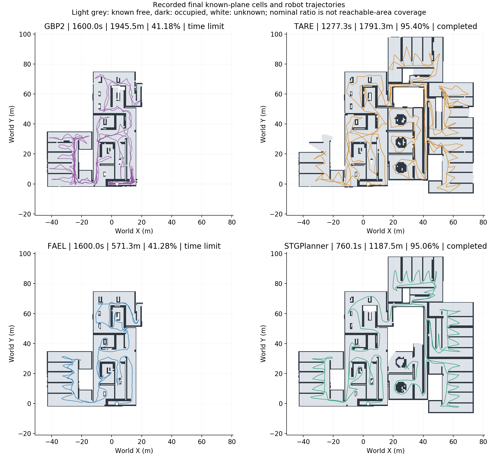

# STGPlanner 本机部署与运行测试报告

部署日期：2026 年 10 月 26 日（北京时间，UTC+8）  
项目：[Haochen-Niu/STGPlanner](https://github.com/Haochen-Niu/STGPlanner)  
源码基线：`59b41451f7b80ba09a9bcbaf44b58141cd6f9de8`（本地保留 Git 历史与修复差异）

## 1. 部署结果

已在 `D:\STGPlanner` 完成部署。28 个 Catkin 包全部编译成功，Scene4 的仿真、激光点云、里程计、局部控制和探索规划能够联动运行；无界面和图形模式的真实 ROS 运行检查均通过。Windows 窗口列表确认 Gazebo、RViz 和实时指标窗口均已创建，图形节点存活检查通过。

后续已定位并修复 `RobotModel`、`topo_map`、`grid_map` 的诊断错误，三个显示项保持启用并通过实际 RViz 状态复验。已重新启动修复后的图形模式并更新截图，见第 6 节。结束演示环境可双击 `D:\STGPlanner\Stop-STGPlanner.cmd`。进一步确认旧 `planner timeout` 混合了正常结束期间的阻塞等待与规划中止；已修复等待响应和日志分类，并完成 20.0 分钟的完整运行观察。默认结束门槛为项目探索指标达到名义地图面积的 95%，不代表 100% 可达空间覆盖。详见第 6 节最新长时间验证。

## 2. 本机环境与目录

| 项目 | 实际配置 |
|---|---|
| 宿主系统 | Windows 11，10.0.22621.2861，x64 |
| GPU | NVIDIA GeForce RTX 4060，8 GB，驱动 546.33 |
| Linux | 独立 WSL2 发行版 `STGPlanner-Ubuntu20`，Ubuntu 20.04 |
| WSL | 2.7.10.0；Linux 内核 6.18.33.2 |
| ROS / 仿真 | ROS Noetic / Gazebo 11 |
| 编译 | GCC 9、CMake 3.16.3、C++17、Release |
| Python | Ubuntu 自带 Python 3.8；NumPy、Matplotlib、Tk 均用 apt 安装 |
| 图形 | WSLg + Mesa 21.2.6 llvmpipe 软件渲染，OpenGL 检查通过 |
| 精确软件版本 | `logs/environment.txt` 和 `logs/installed-packages.tsv` |

```text
D:\STGPlanner\
├─ catkin_ws\src\STGPlanner\   Git 源码与本地修复
├─ wsl\ext4.vhdx              Ubuntu、ROS、依赖、编译产物
├─ downloads\                 已校验的 Ubuntu 基础系统安装包
├─ models\                    官方 grey_wall、gazebo 模型和本地模型库
├─ scripts\                   安装、修复、构建、启动和测试脚本
├─ logs\                      安装/构建/仿真日志、测试数据
├─ ros\                       ROS 用户数据
├─ Start-STGPlanner.cmd        双击启动 Scene4 图形演示
├─ Stop-STGPlanner.cmd         停止本次部署管理的运行实例
├─ Start-STGPlanner.ps1        PowerShell 启动入口，支持 -Headless
└─ Stop-STGPlanner.ps1         PowerShell 停止入口
```

Linux 工作空间为 `/opt/stgplanner/catkin_ws`，其 `src` 链接到 `/mnt/d/STGPlanner/catkin_ws/src`。源码可从 Windows 直接编辑；build、devel 等位于 D 盘 VHDX 内的 Linux 文件系统，以保留 Catkin 所需的 Linux 文件属性并提高构建效率。现有 `Ubuntu-22.04` 未迁移或替换，现有 Conda/Python 环境也未用于本项目。

交付时专用 WSL 虚拟磁盘文件约 **7.17 GiB**；文件按需增长，不会预先占用其显示的最大虚拟容量。

## 3. 日常启动、停止与重新编译

### 图形模式

双击 `D:\STGPlanner\Start-STGPlanner.cmd`，或在 PowerShell 执行：

```powershell
& 'D:\STGPlanner\Start-STGPlanner.cmd'
```

脚本依次启动 Gazebo Scene4、等待激光点云、启动运动控制、等待里程计，最后启动探索策略、RViz 和实时指标绘图。启动过程的详细输出见 `D:\STGPlanner\logs`。

停止时可按启动窗口中的 Ctrl+C，或另开 PowerShell：

```powershell
& 'D:\STGPlanner\Stop-STGPlanner.cmd'
```

停止脚本会终止本项目专用的 `STGPlanner-Ubuntu20` 发行版，保证 Gazebo 和 ROS 后台进程一并退出；因此不要在这个专用发行版中放置其他需要长期运行的任务。

### 只关闭 Figure 1

只关闭当前会话的 Figure 1，保留其他仿真节点：

```powershell
wsl.exe -d STGPlanner-Ubuntu20 -u root -- python3 /mnt/d/STGPlanner/scripts/close_figure1.py
```

绘图节点设置本次 ROS Master 会话的 `suppress_window` 参数后空闲，避免 roslaunch 的自动重启重新弹窗；停止并重新启动整个项目后默认恢复绘图。

### 无界面模式

```powershell
wsl.exe -d STGPlanner-Ubuntu20 -u root -- bash /mnt/d/STGPlanner/scripts/run.sh Scene4 false
```

此模式关闭 Gazebo GUI、RViz 和绘图窗口；原项目的 GPU ray 雷达仍需要 WSLg/OpenGL 渲染支持。

### 修改源码后重新编译

```powershell
wsl.exe -d STGPlanner-Ubuntu20 -u root -- bash /mnt/d/STGPlanner/scripts/build.sh
```

等价的 Linux 构建核心命令：

```bash
source /opt/ros/noetic/setup.bash
cd /opt/stgplanner/catkin_ws
catkin init
catkin config --extend /opt/ros/noetic \
  --cmake-args -DCMAKE_BUILD_TYPE=Release -DCMAKE_CXX_STANDARD=17
catkin build -j4 -p2 --no-status --summarize
source devel/setup.bash
```

### 按 README 分三个终端启动

每个终端先进入指定发行版：

```powershell
wsl.exe -d STGPlanner-Ubuntu20 -u root
```

每个 Linux 终端先执行以下环境设置，再分别执行后面的启动命令：

```bash
source /opt/stgplanner/catkin_ws/devel/setup.bash
export LIBGL_ALWAYS_SOFTWARE=1
export QT_X11_NO_MITSHM=1
export GAZEBO_IP=127.0.0.1
export GAZEBO_MASTER_URI=http://127.0.0.1:11345
export GAZEBO_MODEL_PATH=/mnt/d/STGPlanner/models
export GAZEBO_MODEL_DATABASE_URI=file:///mnt/d/STGPlanner/models/
```

```bash
# 终端 1：仿真
roslaunch exploration_manager sim_env.launch world:=Scene4 gazebo_gui:=true

# 终端 2：运动控制，等待仿真启动后执行
roslaunch exploration_manager robot_move.launch

# 终端 3：探索策略
roslaunch exploration_manager explorer.launch world:=Scene4
```

## 4. 从基础系统重建的部署指令

以下用于理解、复现部署；本机已安装，无需再次导入同名发行版。复现时先将交付材料中的脚本放入 `D:\STGPlanner\scripts`。安装与克隆命令应在能访问 WSL 和 D 盘的 Windows 用户会话运行。

```powershell
New-Item -ItemType Directory -Force D:\STGPlanner\downloads, D:\STGPlanner\scripts, D:\STGPlanner\logs

# 原 Git 全局代理失效，此处只覆盖当前命令，不修改全局配置
git -c core.autocrlf=false -c http.proxy= -c https.proxy= clone `
  https://github.com/Haochen-Niu/STGPlanner.git `
  D:\STGPlanner\catkin_ws\src\STGPlanner
git -C D:\STGPlanner\catkin_ws\src\STGPlanner checkout 59b41451f7b80ba09a9bcbaf44b58141cd6f9de8

curl.exe -fL --retry 2 -o D:\STGPlanner\downloads\ubuntu-base-20.04.5-base-amd64.tar.gz `
  https://cdimage.ubuntu.com/ubuntu-base/releases/20.04/release/ubuntu-base-20.04.5-base-amd64.tar.gz
Get-FileHash D:\STGPlanner\downloads\ubuntu-base-20.04.5-base-amd64.tar.gz -Algorithm SHA256

wsl.exe --import STGPlanner-Ubuntu20 D:\STGPlanner\wsl `
  D:\STGPlanner\downloads\ubuntu-base-20.04.5-base-amd64.tar.gz --version 2

wsl.exe -d STGPlanner-Ubuntu20 -u root -- bash /mnt/d/STGPlanner/scripts/bootstrap.sh
wsl.exe -d STGPlanner-Ubuntu20 -u root -- python3 /mnt/d/STGPlanner/scripts/patch_deployment.py
wsl.exe -d STGPlanner-Ubuntu20 -u root -- bash /mnt/d/STGPlanner/scripts/build.sh
wsl.exe -d STGPlanner-Ubuntu20 -u root -- bash /mnt/d/STGPlanner/scripts/verify_environment.sh
```

Ubuntu 安装包实际 SHA256：

```text
60e216b60947653dc8989be3821380268315b99b2959c29882781541bfe5a426
```

该值与 [Ubuntu 官方 SHA256SUMS](https://cdimage.ubuntu.com/ubuntu-base/releases/20.04/release/SHA256SUMS) 一致。系统采用独立 WSL 导入，参见 [Microsoft WSL 命令文档](https://learn.microsoft.com/en-us/windows/wsl/basic-commands)。

`bootstrap.sh` 的主要工作为配置 Ubuntu focal 软件源、安装基础编译工具、导入 ROS 官方签名密钥、配置清华 ROS 镜像并安装 `ros-noetic-desktop-full` 和控制/建图依赖。`build.sh` 补充 Velodyne、TF2 sensor messages、Matplotlib/Tk，并进行完整构建。依赖清单与准确指令均保存在脚本中；apt 验签保持启用。

`install_assets.sh` 使用 Git 稀疏检出安装 [OSRF 官方 Gazebo 模型](https://github.com/osrf/gazebo_models)，固定提交 `8163eb4b5e7e21985c6591d1c0bfb56468c0093f`，仅取 `grey_wall` 和 `gazebo` 两个目录；由 `build.sh` 自动调用。资源校验值见 `logs/model_checksums.txt`。

## 5. 遇到的问题与解决措施

| 问题 / 证据 | 解决措施与验证 |
|---|---|
| Windows 与上游 Ubuntu 20.04 / ROS Noetic 平台不一致；现有 WSL 是 Ubuntu 22.04 | 新建 D 盘独立 Ubuntu 20.04 发行版，安装 ROS Noetic / Gazebo 11，不混用 Windows Python 3.14 或现有 Conda。 |
| Git 报连接 `127.0.0.1:33210` 失败 | 确认为失效的全局代理；使用当前命令的 `http.proxy=` / `https.proxy=` 覆盖下载，未修改用户全局 Git 代理。 |
| 官方 `packages.ros.org` HTTPS 证书域名校验失败 | 改用清华 ROS 镜像并导入 ROS 官方签名密钥；未关闭 TLS 校验或 apt 验签。 |
| README 仿真命令缺少包名，且默认场景/参数文件并不存在 | 改为 `roslaunch exploration_manager sim_env.launch`；默认场景固定为实际提供的 `Scene4`，规划参数改为 `topo_planner_Scene4.yaml`；使用 Bash 的 `setup.bash`。 |
| 首次编译报 `tf2_sensor_msgs/tf2_sensor_msgs.h: No such file or directory` | 安装 `ros-noetic-tf2-sensor-msgs`，补齐 CMake 和 package.xml 依赖，修正 `tf_ros` 拼写；将导出的不存在库 `simulation` 改为实际的 `slam_output`。重编译 28 包全部成功。 |
| `robot_description` 无法执行 `jackal_description/scripts/env_run` | Windows Git CRLF 换行破坏 Linux 脚本头；统一相关脚本为 LF、恢复执行位、添加 `.gitattributes`。ROS 模型展开和三个 launch 检查通过。 |
| Gazebo 报 `model name jackal already exist` | Scene4 世界文件内保存了旧 Jackal，含作者机器 `/home/nhc/...` 网格绝对路径。移除该保存机器人，改由 URDF 生成；修复脚本校验其余环境模型名称集合完全保持一致。新机器人生成成功。 |
| 物理仿真初始化停滞，Gazebo 等待远程模型库；随后发现凉亭网格缺失 | 补齐官方 `grey_wall` 和 `gazebo` 模型及贴图；修正 `GAZEBO_MODEL_PATH` 的 roslaunch 变量语法，使用本地模型库，消除缺失场景资源对仿真和碰撞的影响。 |
| 初版部署启动器在 ROS Master 尚未就绪时过早返回，且场景可能处于暂停状态 | 改为有截止时间的服务/话题重试，显式解除物理暂停，顺序等待点云和里程计后才启动探索；为超时命令增加强制终止期限。正式启动验证通过。 |
| 统计输出目录不存在，Python 绘图脚本缺少正式安装规则 | 自动创建 `files/exploration_data`；添加 `catkin_install_python`，安装 Matplotlib/Tk。统计文件在实际测试中产生。 |
| 自动化运行时不希望强制开启可视化窗口 | 增加 `rviz`、`plot` 可选参数，默认保留图形显示；无界面测试显式关闭。 |
| 图形模式下 Gazebo 宣告了 WSL 的非回环地址，传感器桥接/客户端联动不正常 | 将 `GAZEBO_IP` 固定为 `127.0.0.1`，显式设置本机 Gazebo Master 地址；改用 `AnyMsg` 订阅检查话题就绪，避免 rostopic 动态类型解析的短超时。图形模式 60 秒联动检查通过。 |
| WSL 重启复用 PID，旧 PID 文件误报已有实例 | 将启动互斥改为 `flock`，专用停止入口使用 `wsl --terminate STGPlanner-Ubuntu20`，只终止本项目发行版；已验证停止后重新启动。 |
| 补充截图时发现 RViz 采用作者的大屏窗口尺寸和跟随视角 | 将窗口调整为 1600×900，保留 Displays 面板，使用固定 world 地图视角，方便在本机完整查看建图区域；原配置另存备份。 |
| 实时指标窗口没有处理 Tk 事件，重绘/交互不及时 | 绘制后增加 `plt.pause(0.001)` 处理 GUI 事件，重启绘图节点后已看到持续更新的累计指标曲线。 |
| RobotModel：虚拟里程计传感器链接缺少到 world 的 TF | 原关节为零行程 revolute，但没有相应 joint_states。改为 fixed，并使用 preserveFixedJoint 保留 Gazebo 插件需要的链接；URDF/SDF 结构、全部机器人链接的 TF 和运动回归均验证通过。 |
| topo_map / grid_map：Points should not be empty for specified marker type | 空类别原来发送空点集 ADD。修复实际发布函数，空类别改发 DELETE 清除旧图元，非空图元不变；实际消息审计及 RViz 连续状态检查通过。 |
| 正常结束前出现 planner timeout，且其他规划失败也被同名记录 | 默认 95% 指标门槛先触发统计节点结束并关闭规划器；客户端阻塞等待结果，未及时处理结束信号。改为处理回调的有界轮询，及时取消结束期间的请求；区分 SUCCEEDED、ABORTED 等状态和真正的 60 秒墙钟超时；记录明确的结束原因、指标与门槛。隔离回归和长时间真实运行均通过。 |
| 首轮长测结束后局部跟随器偶尔仍输出转向命令 | 停车回调的循环条件在刚进入时恒为假；Bool 停车话题没有订阅者。改为有 7 秒墙钟上限、至少持续 2 秒的停车确认；将 latched Bool 接入实际 pathFollower，覆盖线速度和角速度，下一条有效路径才释放停止。增加速度命令与位置稳定检查后，重新执行完整长测。 |

仍可见的非阻塞诊断：

- 完整构建有 7 个包带警告，包括旧 Gazebo API 弃用、PCL 可选 I/O 功能、UFOMap 的重载/返回值相关警告；没有编译失败。本次未改写上游规划算法来消除这些警告。
- `gazebo_ros_control` 会打印四个车轮缺少 PID 增益。当前机器人采用 `VelocityJointInterface`；[官方控制插件源码](https://github.com/ros-simulation/gazebo_ros_pkgs/blob/noetic-devel/gazebo_ros_control/src/default_robot_hw_sim.cpp) 在缺少 PID 参数时回退到直接关节速度控制。实测运动链路通过，因此保留原控制方式，没有随意填写 PID 改变动力学。
- WSL 会提示宿主 localhost 代理未映射到 NAT 网络；本项目下载过程已使用可访问的源，ROS/Gazebo 使用本机通信，测试通过。此提示不等于项目依赖安装失败。


## 6. 运行测试与证据

- 完整构建：`All 28 packages succeeded`，0 失败、0 跳过；修复后的完整构建耗时约 15 分 26 秒。
- 环境和启动检查：Ubuntu、ROS、Gazebo、PCL、OpenCV、TBB 版本已记录；OpenGL 可用；三个启动文件解析成功。
- 两次运行测试均直接订阅项目话题，不使用合成数据或模拟测试结果。以下位移只统计采集窗口；项目自己上报的累计距离可能包含测试脚本启动前的运动，因此两者不必完全相同。

| 指标 | 无界面模式 | 图形模式 |
|---|---:|---:|
| 实际采集时长（秒） | 180.0 | 60.1 |
| 仿真时间推进（秒） | 178.80 | 49.83 |
| 采集窗口的实时因子 | 0.99 | 0.83 |
| 收到的点云帧 | 1788 | 498 |
| 每帧最大点数 | 28579 | 28628 |
| 收到的里程计消息 | 1788 | 498 |
| 采集期间里程计累计位移（米） | 264.40 | 81.86 |
| 非零速度命令数 | 1788 | 498 |
| 局部路径消息数 | 1788 | 498 |
| 成功且非空的探索规划数 | 1129 | 262 |
| 项目上报最大探索指标 | 2147.68 | 1226.24 |
| 关键节点存活 | 全部通过 | 全部通过 |
| 全部自动检查 | PASS | PASS |

探索指标沿用上游消息字段 `exploredVolume`。程序对外标注面积/体积的用法不完全一致，本报告不将该数值当作独立校准的面积测量结果。



原始轨迹 CSV、完整指标 JSON 和节点/话题快照随部署材料交付。

### 补充的真实图形运行截图

图 1～3 保留上一轮演示的真实 Windows 窗口截图，作为部署过程与修复前状态的历史记录；图 4 是本次长时间测试结束后的最新 RViz 画面。图 4 从运行中的 RViz 同一次回调读取 Qt 面板和 OGRE 视口帧缓冲，避免 WSLg 普通截图接口返回黑屏或错误窗口。所有截图均来自实际运行，没有生成或重绘地图及状态文字；时间与捕获方法见 `screenshots/capture_manifest.json`。图 3 和图 4 不属于同一轮次，不能用于直接比较完成进度；图 5 提供与图 4 同轮的完整指标记录。

**图 1：Gazebo 的 Scene4 场景。** 可见仓库提供的墙体、走廊和三座凉亭，以及物理仿真状态栏。



**图 2：修复前的 RViz 建图与轨迹（历史对照）。** 左侧三个红色诊断是本次修复的对象；此图不代表当前状态。修复后的三个 Ok 状态和地图见图 4。



**图 3：上一轮演示的实时探索指标（历史记录）。** 展示项目上报的探索量、累计行走距离及每轮规划耗时。绘图节点中途重启导致曲线起始段直接连接至当时的累计值；定量复验使用下方 JSON 记录。



RViz 的 ROS 1 生命周期说明弹窗已关闭。显示调整不改变规划算法或运动控制参数。交付时保留仿真和图形窗口，探索已按 95% 指标门槛停止，可使用本报告提供的停止入口结束整个环境。

补充截图期间另外执行了 30.1 秒实际运行检查：265 帧点云、42.12 米位移、111 次成功且非空规划，9 项检查均通过。原始数据为 `logs/screenshot_demo/runtime_current.json`。

历史演示轮次后续日志显示 `the exploration process has finished`，程序报告总耗时 `940.312803 s`；最后一条统计记录为累计行走 `1224.75 m`、项目探索指标 `7436.64`。这些属于程序自身的统计和结束判据，不能据此声称所有场景或所有可达区域均已被无遗漏覆盖。该轮结束日志与统计保存在 `logs/screenshot_demo/`，不与本次修复后的新一轮数据混用。

### RViz 三项诊断修复与复验

修复前从 RViz 自身的状态属性读取到：RobotModel 为虚拟传感器链接缺少 TF；topo_map 的 skeleton/6、myTopo/7 等类别，以及 grid_map 的 unknown/3 等类别报空点集 Marker 错误。实际订阅审计也记录到对应空 ADD。基线见 `logs/rviz_repair/markers_status_before.json` 和 `markers_before.json`。RViz 的判定依据可参见 [官方 Marker 校验源码](https://github.com/ros-visualization/rviz/blob/noetic-devel/src/rviz/default_plugin/marker_utils.cpp)。

修复涉及三个实际源码文件：`VLP_16.urdf.xacro`、`global_topo_manager.cpp`、`grid_map_2d.cpp`。没有关闭这三个显示项，也没有改变其订阅话题或用固定“正常”文本代替真实状态。

- 机器人模型：16 个链接均可变换到 world，虚拟传感器连接为 fixed，Gazebo 保留了传感器链接及插件引用。
- RViz：三个显示项均启用，连续 10 次状态采样为 Ok，覆盖 17.7 秒。状态直接从实际加载同一配置的 RViz 显示组件读取。
- topo_map：收到 263 条实际消息，空 ADD 为 0，DELETE 为 526，非空 ADD 为 1578，非法浮点/奇数线段点集均为 0。
- grid_map：收到 254 条实际消息，空 ADD 为 0，DELETE 为 254，非空 ADD 为 1016，非法浮点/奇数线段点集均为 0。
- 修复后运动规划回归：60.2 秒，行走 69.37 米，成功且非空规划 256 次，运行检查通过。

**图 4：本次长时间测试达到 95% 指标门槛后的 RViz。** 三个显示项保持勾选，分别显示绿色 `Status: Ok`，右侧为真实地图和规划可视化。为完整显示 Scene4，视角中心设为 `(15,40,0)`、距离 190；白色路径由 RViz 接收的数据绘制，完整记录的里程计轨迹见图 5。



前次 RViz 修复复验汇总：`logs/rviz_repair/verification_summary.json`；原始状态历史、TF 审计、模型转换结果、构建日志和消息审计均随材料交付。该次增量编译仅重建 planner，未改动的 27 个包沿用已通过的构建产物；本轮长测的新增修复见下文。

历史 RViz 修复后的演示在程序报告的 `1051.394369 s` 后退出；进一步核查表明，统计节点先达到 95% 门槛并关闭规划器，客户端约 81.4 秒墙钟（约 70 秒仿真时间）后才打印 timeout 并处理结束信号。原报告对“上游终止行为”的表述不足以说明此等待问题，现已补充根因、修复和完整复验；日志保留于 `logs/rviz_repair/fixed_run/` 和 `logs/planner_completion/baseline/`。

复现本次修复与检查（先停止运行实例，编译完成后重新启动）：

```powershell
wsl.exe -d STGPlanner-Ubuntu20 -u root -- bash /mnt/d/STGPlanner/scripts/build_rviz_repair.sh
& 'D:\STGPlanner\Start-STGPlanner.cmd'
# 在另一 PowerShell 窗口、机器人开始运动后执行 60 秒审计
wsl.exe -d STGPlanner-Ubuntu20 -u root -- bash /mnt/d/STGPlanner/scripts/verify_rviz_repair.sh
```

状态截图辅助程序需要先执行 `build_rviz_capture.sh` 编译原生捕获库，再运行 `rviz_status_probe.sh /mnt/d/STGPlanner/logs/rviz_repair/status_after.json`。它加载项目的实际 RViz 配置和话题；此附加窗口用于取证，常规启动使用原 RViz。

### planner timeout 根因与长时间完整运行验证（最新）

**截图中的残余区域与结束判据。** 图 3 是早先轮次中的指标窗口；图 4 已更新为本次完整运行结束后的地图。图中未覆盖部分可能包含未探索空间、障碍物内部、边界外或无法通过的区域，单凭颜色无法确认其可达性。源码的实际默认判据是 `known_space_volume > 0.95 * map_area`，Scene4 的 `map_area=7790`，即指标超过 `7400.5` 即停止；因此程序报告结束时仍可能有残余区域。本次保留该门槛，没有把结束阈值调高或把未知区域当成已覆盖。

**根因证据。** 旧轮次统计节点在仿真时间 `16072.288` 记录 `max volume threshold is reach...` 并广播结束、关闭规划器；客户端仍处于 `sendGoalAndWait(60s, 10s)`，直到 `16142.255` 才打印 `planner timeout`。旧接口还把 ABORTED 等任何非成功结果都打印成 timeout，故该日志本身无法证明计算卡死，也不能一概当作正常完成。

**实际修复。** `ControlPlannerInterface::callForPlanner` 改为处理 ROS 回调的等待循环，收到探索结束时取消当前请求并返回；采用 60 秒墙钟期限，区分成功、ABORTED 等终态与真正超时。Explorer 将完成标志保持为真，结束时不再打印重试警告；统计节点记录 `EXPLORATION_STOP reason=coverage_threshold` 及实际指标，并保留可读取的 `finish_reason` 参数。

**长测进一步发现并修复停车问题。** 首轮 20 分钟记录虽然通过初版 13 项检查，但末期仍出现角速度命令（最大线/角速度命令绝对值之和约 1.0472），因此未作为最终停车验收。源码中 `stopMoveCallback` 以“启动后已超过 2 秒”作为进入循环的条件，刚开始便跳过；它发布的 Bool 话题也未接入 pathFollower。现已修正循环、保持停车发布为 latched，并接入跟随器同时清零线/角速度；新有效路径才释放该停止状态，原有独立 `/stop` 功能保留。最终数据来自加强检查后重新执行的第二轮完整长测，首轮证据保留在 `logs/planner_completion/first_long_before_stop_fix/`。

隔离接口回归使用独立 `/completion_regression` 命名空间和无运动 PCI：成功路径返回通过；ABORTED 在 0.020 秒返回且保留状态；回调触发的正常结束在 0.254 秒内取消；注入不返回结果的服务端后，在 60.005 秒出现明确的真实超时。该项属于受控故障注入，不与下方真实场景数据混用。

| 最新真实场景检查 | 实测结果 |
|---|---:|
| 完整观察时长 | 1200.1 秒（20.0 分钟） |
| 初始化完成至指标门槛 | 968.99 秒（16.1 分钟） |
| 结束原因 | coverage_threshold |
| 最终项目探索指标 | 7405.44 / 7790（名义比值 95.063%） |
| 实际订阅点云帧 | 9801 |
| 实际订阅里程计消息 | 9797 |
| 采集期间里程计距离 | 1217.25 米 |
| 成功且非空规划次数 | 3646 |
| Action 结果状态计数 | {'3': 3646, '4': 6} |
| 结束信号与 Explorer 结束事件的接收时差 | <0.001 秒 |
| 结束后仿真时钟继续推进 | 202.18 秒 |
| 结束 10 秒后最大里程计速度 | 0.000308 m/s |
| 结束 10 秒后最大速度命令绝对值之和 | 0.000000 |
| 结束 10 秒后累计位置变化 | 0.021256 米 |
| 停车 action 结果 | SUCCEEDED |
| 真实超时 / 旧误导 timeout 日志 | 均未出现 |
| RViz 三项诊断 | 均启用，末尾连续 10 次为 Ok |
| 生命周期检查 | 16 项全部 PASS |

Action 状态 3 表示 SUCCEEDED，4 表示 ABORTED；短暂 ABORTED 按重试分支处理，实际次数见上表。测试允许达到门槛后规划/统计节点主动退出，要求仿真、里程计和静止状态继续正常；不会把预期退出误判为节点崩溃。完整观察时长包括达到门槛后的静止观察，实际探索时长单独列出。

**图 5：与图 4 同一轮的完整指标及轨迹。** 图由实际 ROS 订阅记录和项目统计文件绘制；虚线标出默认停止门槛。名义比值不等同于独立测量的真实可达区域覆盖率。



复验原始证据：`logs/planner_completion/long_runtime.json`、逐条指标/事件 JSONL、节点与内存采样、`long_run_statistics/`、退出日志和 `isolated_regression.json`。首轮监测时 Windows 挂载盘出现并发追加事件行交错，最终记录器已加锁；归档同时从完整内存记录保存的最终 JSON 按时间重序列化 JSONL，原追加文件另存 `long_runtime.events.raw.jsonl`。此修正只涉及监测记录的文件写入。便于阅读的摘要为 `长时间运行验证结果.json`。本轮重建了 `control_planner_interface`、`exploration_manager`、`visualization_tools`、`path_execution`、`local_planner` 五个包，其余构建产物沿用已验证版本。

复现该轮测试时，先停止现有实例，在 PowerShell 依次运行：

```powershell
& 'D:\STGPlanner\Stop-STGPlanner.cmd'
wsl.exe -d STGPlanner-Ubuntu20 -u root -- bash /mnt/d/STGPlanner/scripts/build_planner_completion.sh
wsl.exe -d STGPlanner-Ubuntu20 -u root -- bash /mnt/d/STGPlanner/scripts/long_session.sh
```

长测最少观察 1200 秒，达到门槛后至少再观察 120 秒，最大期限 2400 秒；结果写入 `D:\STGPlanner\logs\planner_completion\long_runtime.json`。最终结果生成后仿真窗口继续保留，使用停止入口结束。首次重建环境需先执行 `build_rviz_capture.sh`，以便取证窗口导出图 4。

### 首次单方法验收：复现范围与论文表 I 对照（历史记录）

完整克隆并构建了公开仓库的 28 个包，实际运行了 Scene4 的感知、建图、拓扑规划、局部控制和可视化链路，并修复了部署及运行故障。此结论属于“公开代码的 Scene4 功能复现”，并非论文全部实验的独立重复验证。完整源码保留在 `D:\STGPlanner\catkin_ws\src\STGPlanner`；材料包包含脚本与补丁，没有把完整仓库和 WSL 磁盘重复打包。

论文图 5 / 表 I 包含 Scene1～4；当前公开仓库只提供 Scene4 的 world 与配套参数。首次单方法验收尚未运行其他三个论文场景及GBP2/TARE/FAEL基线；后续Scene4基线部署和实际对比见第8节。至本次更新仍未按论文要求在相同配置下重复5次计算均值和标准差；两轮长测承担排错和验收用途，不能当作同配置的五轮统计。也未逐项证明公开源码与论文所有算法细节完全一致。

论文数字来自 [论文表 I 和实验设置](https://arxiv.org/html/2412.13664v1#S4)，取 Scene4 的 Ours；本机取最终严格长测的单轮记录：

| 指标 | 论文 Scene4 / Ours | 本机最终单轮 | 解释 |
|---|---:|---:|---|
| 探索耗时 | 779.8 ± 17.2 s | 墙钟 968.99 s；ROS 仿真 776.67 s | 墙钟数值高 24.26%；仿真时长数值相差 -0.40%。论文未明确所用统计时钟，不能直接认定严格一致。 |
| 路径长度 | 1194.0 ± 12.9 m | 1214.97 m | 项目累计距离高 1.76%；数值较接近，但一轮结果不能验证论文均值和标准差。 |
| Run time / 规划计算时间 | 0.015 s | 内部迭代均值 0.06255 s | 约 4.17 倍；采用项目 iteration_time 计时，尚未逐项统一论文计时边界与硬件。 |
| 平均速度 | 1.53 m/s | 按 ROS 仿真时间 1.564 m/s；按墙钟 1.254 m/s | 由同一累计距离分别除以两种时长推导，不能混用。 |
| 统计口径 | 每场景、每方法重复 5 次 | 最终单轮；其余运行用于排错 | 未进行论文级统计复现。 |

ROS 时钟由本轮 Explorer 的“init motion has finished”与“exploration process has finished”两条实际事件读取：`15272.588` 至 `16049.261`；墙钟时间采用项目统计节点 `timeConsumed`，不使用含停车观察的 1200 秒测试总时长。路径采用与该时间窗口对应的项目累计距离；报告中的 1217.25 米里程计采集值还包含监测启动后的初始化运动和静止波动，不能替换此处口径。

本机运行于 Windows / WSL2，Gazebo 和 RViz 使用 CPU 软件渲染；论文使用 Ubuntu 20.04、i9-10900K，最大运动速度设置为 2 m/s。本机配置的 maxSpeed 同样为 2 m/s，但探索期间 ROS 仿真时间与墙钟时间比约为 0.802，所以渲染/仿真变慢会拉长墙钟耗时。硬件、负载、仿真调度、结束门槛和计时边界尚未全部统一，不能把数值差异单独归因于算法，也不能据此验证论文对其他方法的领先比例。

结论：Scene4 的功能链路已跑通，路径长度和按仿真时间推导的速度较接近论文；本机墙钟耗时和内部规划计算时间较高。当前证据支持工程部署与功能复现，不支持“论文全部性能结果已复现”。原始对照数据见 `logs/paper_comparison.json`。


### 自行复测

先启动项目，再另开 PowerShell 运行：

```powershell
wsl.exe -d STGPlanner-Ubuntu20 -u root -- bash -lc `
  'source /opt/stgplanner/catkin_ws/devel/setup.bash; python3 /mnt/d/STGPlanner/scripts/runtime_test.py --seconds 180 --output /mnt/d/STGPlanner/logs/runtime_retest.json'
```

测试使用真实 ROS 订阅数据，核对激光点云、里程计、非零速度命令、局部路径、成功且非空的探索规划、探索量指标及仿真时钟。测试进程退出码为 0 表示这些检查全部通过；退出码为 1 表示至少一项未满足。测试本身不会发送运动指令，运动来自项目的探索和控制节点。

## 7. 交付材料与验证边界

- 本报告：本次实际部署步骤、故障修复、命令和验证结果。
- `STGPlanner部署材料.zip`：部署/测试脚本、本地源码补丁、环境版本、安装依赖清单、模型提交与校验值、构建日志和两次运行测试数据。
- `runtime_trajectory.png`：真实里程计轨迹图，来自无界面测试采集数据。
- `long_run_metrics.png`、`长时间运行验证结果.json`：最新完整探索轮次的指标图和复验摘要。
- `screenshots/`：更新后的运行画面、三个显示项正常状态的截图及捕获元数据。
- `STGPlanner部署报告.html`：嵌入图片的单文件浏览版报告，便于直接打开。
- D 盘实际运行环境与源码保留在 `D:\STGPlanner`。压缩包不包含数 GB 的 WSL 虚拟磁盘或 Ubuntu 安装镜像；完整环境直接保留在本机。

本次针对仓库提供的 `Scene4` 和当前机器进行部署测试。测试时长与指标见上表；不代表已经覆盖所有探索过程、所有随机种子或真实机器人场景。渲染使用 CPU 软件后端，不能将测试速度当作 RTX 4060 硬件渲染性能。Ubuntu 20.04 / ROS Noetic 是为匹配上游要求而固定的环境，后续升级系统或 ROS 时需要重新验证依赖与 Gazebo 插件兼容性。

## 8. Scene4 三种论文基线的本机部署与对比

追加日期：2026年10月27日 10:55（北京时间）。已实际部署 GBP2、TARE、FAEL，并在同一 Scene4 上完成各1次正式长测；同时补测 STGPlanner。本次完整方法、修复、指令和原始数据说明见 [Scene4基线算法对比报告](Scene4基线算法对比报告.html)。原第6节的历史 STGPlanner 单方法验证保留；下表使用新统一观察器和修复后的公共控制器，属于另一批试验。

| 方法 | 结束状态 | 仿真时间(s) | 距离(m) | 已知平面指标名义比值 |
|---|---|---:|---:|---:|
| GBP2 | 1600s限时未完成 | 1600.04 | 1945.54 | 41.179% |
| TARE | 达到统一95%门槛 | 1277.28 | 1791.35 | 95.402% |
| FAEL | 1600s限时未完成 | 1600.04 | 571.34 | 41.278% |
| STGPlanner | 达到统一95%门槛 | 760.10 | 1187.54 | 95.061% |

论文每方法5次均值±标准差，本批次仅每方法1次，且基线版本、适配接口和硬件不同，不能宣称严格复现论文统计结论。限时记录不能当作完整探索结果。





源码、配置、补丁和结果备份到私有仓库的 `benchmark/scene4-baselines` 分支；原 `main` / `repro-baseline-2026-10-26` 保留。完整交付为 `Scene4基线对比材料.zip` 和 `Scene4对比结果.json`。
