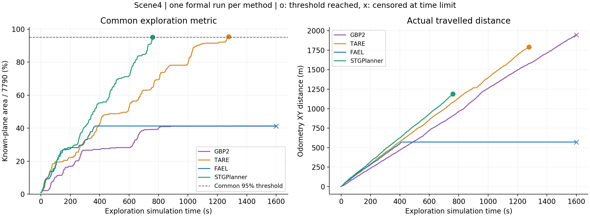
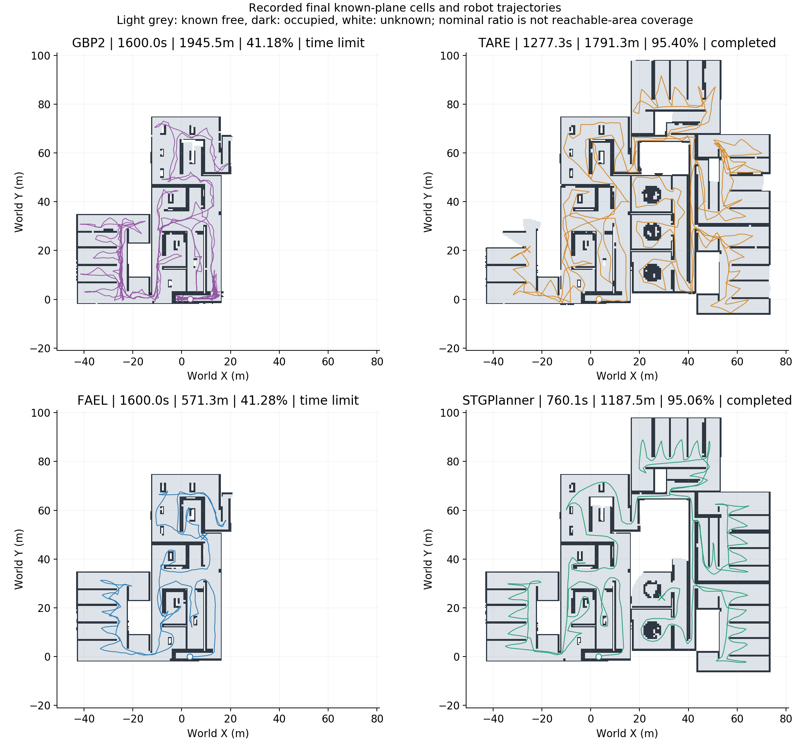
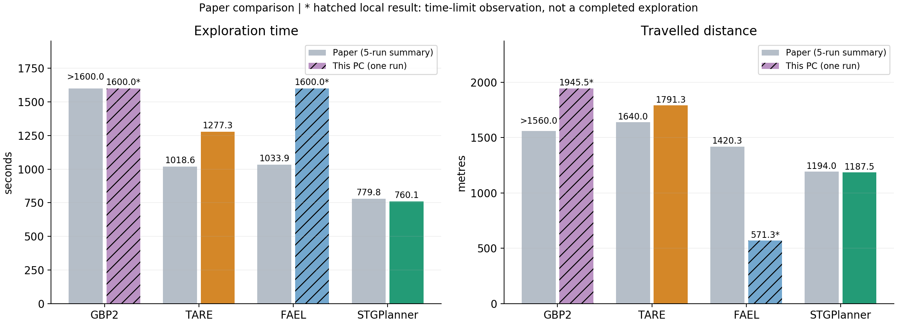

# Scene4：GBP2、TARE、FAEL 与 STGPlanner 本机部署对比报告

<!-- scene4-stage-summary:start -->
> **阶段状态（2026-10-27）：Scene4四算法基线测试已阶段性完成。STGPlanner、TARE、修复FAEL达到本地公共95%；GBP2修复09在2400.007秒限时结束，覆盖56.338896%，未完成。GBP2保持用户暂停，不启动后续测试。本阶段是单次工程验证与对照归档，不是论文五次统计复现。**

## 最新四算法与论文数据对照

| 算法（本地版本） | 探索时间(s)：论文 → 本地 | 路径长度(m)：论文 → 本地 | 平均规划耗时(s)：论文 → 本地 | 平均速度(m/s)：论文 → 本地 | 本地覆盖指标 | 本地判定 |
|---|---:|---:|---:|---:|---:|---|
| STGPlanner（本机基线01） | 779.8±17.2 → 760.100 | 1194.0±12.9 → 1187.544 | 0.015 → 0.0405 | 1.53 → 1.562 | 95.0614% | 达到公共95% |
| TARE（本机基线01） | 1018.6±82.3 → 1277.279 | 1640.0±135.3 → 1791.349 | 0.338 → 0.2514 | 1.61 → 1.402 | 95.4023% | 达到公共95% |
| FAEL（原生修复01） | 1033.9±149.8 → 1017.008 | 1420.3±128.4 → 1351.931 | 0.119 → 0.0380 | 1.37 → 1.329 | 95.3366% | 达到公共95% |
| GBP2（原生修复09） | >1600（Std —） → 2400.007（限时） | >1560（Std —） → 2413.450 | 0.465 → 1.0080 | 0.97 → 1.006 | 56.3389% | 限时未达95% |

## 口径与结论

- 本地成功定义为公共观察器的已知平面面积/7790m²达到95%（面积>7400.5m²），并通过停车和传感器验收；不是算法自然结束或严格可达区域100%覆盖。论文未提供可直接对应的本地覆盖比例，故不填造论文覆盖率。
- GBP2的2400.007秒、2413.450米是限时观测窗口及其部分探索轨迹，不是完成时间/完整覆盖路径。论文的>1600和>1560同样不是准确完成值；Std横杠表示未提供，不能单独断言成功或崩溃，因此不计算GBP2相对论文的完成性能差。
- FAEL使用修复后的01运行，GBP2使用最新修复/校准后的09运行；两者含本地实现改动，不能与未经改动的上游/作者配置画等号。原FAEL1600秒41.2775%、原GBP2 1600秒41.1789%及全部中间失败/中止数据均保留，未用后续结果覆盖。
- 规划耗时按各代码原生统计范围：STGPlanner/FAEL为IterationTime，TARE为/runtime分项和，GBP2为服务回调内部稳态时钟。统计边界、CPU和负载不同，不能据此宣称跨论文的计算效率排名。本地速度是里程/探索仿真时长，含转向、等待及停滞，不是2m/s速度上限。
- 完成运行的单次数值对照：STGPlanner时间比论文均值低2.53%、路径低0.54%；FAEL时间低1.63%、路径低4.81%；TARE时间高25.40%、路径高9.23%。这些是描述性差值，不证明改进/退化或统计显著性。

完整数值、原始结果选择与SHA见[四算法论文对比汇总](Scene4四算法与论文对比汇总.html)。目录与脚本用途见[代码目录说明](代码目录说明.html)。下方保留原报告及历史测试过程。
<!-- scene4-stage-summary:end -->

> **本次整理结论：FAEL本地一次完整运行达到95.3366%，GBP2最新完整2400秒运行仅56.338896%，未达到95%。用户已暂停GBP2后续测试；保留全部基线、失败、中止数据及源码修改，按当前分支备份到私有仓库。此备份不表示全部问题已修复，也不代表论文五次统计复现。**


> **2026-10-27 后续更新：** 本页保留修复前的历史结果。FAEL、GBP2 的新增源码修复及长测结果见 [探索停滞修复报告](Scene4探索停滞修复报告.html)，原始旧结果未覆盖。

更新：2026年10月27日 11:00（北京时间）<br>
项目目录：`D:\STGPlanner\benchmarks`<br>
版本分支：`benchmark/scene4-baselines`，原 `main` / `repro-baseline-2026-10-26` 保留。

## 1. 完成范围与结论的适用范围

已实际编译、部署并在同一 Scene4.world 中串行运行 GBP2、TARE、FAEL，同时重新运行 STGPlanner 作为本机参照。每种方法先通过真实车辆运动、建图及停车短测，再执行一次正式试验。下表来自实际 ROS 点云、车体里程计和原生算法消息记录。

这属于公开代码的独立集成复测。论文使用五次试验的均值±标准差，本批次每种方法只有一次正式试验，不能据此宣称复现了论文统计结果或算法排名。作者用于基线比较的确切提交、参数和改版 FALCO 接口未完整提供；本机为 i5-13400F / WSL2 / llvmpipe 软件渲染，论文为 Ubuntu20.04 / i9-10900K。

## 2. 本机正式测试结果

| 方法 | 结束状态 | 仿真时间(s) | 墙钟时间(s) | 里程计距离(m) | 已知平面面积 / 名义比值 | 平均速度(m/s) | 原生规划均耗时(s) |
|---|---|---:|---:|---:|---:|---:|---:|
| GBP2 | 1600s 限时未完成 | 1600.04 | 1612.80 | 1945.54 | 3207.84（41.179%） | 1.216 | 0.2890 |
| TARE | 达到统一门槛 | 1277.28 | 1288.35 | 1791.35 | 7431.84（95.402%） | 1.402 | 0.2514 |
| FAEL | 1600s 限时未完成 | 1600.04 | 1613.25 | 571.34 | 3215.52（41.278%） | 0.357 | 0.0182 |
| STGPlanner | 达到统一门槛 | 760.10 | 763.86 | 1187.54 | 7405.28（95.061%） | 1.562 | 0.0405 |

完成门槛统一为项目已知平面统计面积 **>7400.5m²（7790×95%）**，包含已知自由和占用体素；不是严格测得的可达区域覆盖率。距离排除初始化和停止后的停车段。平均速度为该距离除以探索仿真时间。限时未完成方法的时间和距离只是观测窗口内的记录，不能当作完成整张地图所需的时间和长度。

**本次实际结论：** STGPlanner以760.10s、1187.54m达到门槛；TARE以1277.28s、1791.35m达到门槛。GBP2仍持续运动，但1600s时指标仅41.179%；FAEL在约415s后停止有效推进，最终为41.278%，两者均没有完成。测试调度已于2026年10月27日02:31结束，仿真进程随后停止。





地图来自各自试验的独立公共观察器与1Hz轨迹抽样。图内灰色为已知自由，深色为占用，白色为未知；显示范围按场景边界统一裁切，指标累计仍采用上游项目定义。终点“×”是记录结束位置，不是人为指定探索目标。

## 3. 与论文 Table I 的比较

| 方法 | 论文探索时间(s) | 论文路径长度(m) | 论文运行时间(s) | 论文速度(m/s) |
|---|---:|---:|---:|---:|
| GBP2 | >1600 | >1560 | 0.465 | 0.97 |
| TARE | 1018.6±82.3 | 1640.0±135.3 | 0.338 | 1.61 |
| FAEL | 1033.9±149.8 | 1420.3±128.4 | 0.119 | 1.37 |
| STGPlanner | 779.8±17.2 | 1194.0±12.9 | 0.015 | 1.53 |

下列相对差只描述“本次单次记录相对于论文均值”，不代表具有统计显著性的提高或退化。此处以本机ROS仿真时间作数值对照；论文未明确相同的墙钟/仿真时钟口径，本机墙钟时间另列，不能仅凭数值接近认定性能一致。

| 方法 | 探索时间相对论文均值 | 路径长度相对论文均值 |
|---|---:|---:|
| GBP2 | 无法计算同口径完成时间差 | 本次记录为限时内部分轨迹 |
| TARE | +25.40% | +9.23% |
| FAEL | 无法计算同口径完成时间差 | 本次记录为限时内部分轨迹 |
| STGPlanner | -2.53% | -0.54% |



规划耗时使用各代码的原生统计范围：STGPlanner/FAEL 为 IterationTime，TARE 为 /runtime 分项和，GBP2 为服务回调内部稳态时钟；另存客户端请求墙钟延迟。它们并非完全相同范围的微基准，CPU、日志和仿真负载也不同，不能单凭此列作严格的计算效率结论。

以本机仿真时间作数值对照，STGPlanner的耗时比论文均值低2.53%，路径长度低0.54%；TARE的耗时高25.40%，路径长度高9.23%。这只说明本次观测值的差异，不能据此认定改进、退化或复现了均值。GBP2只与论文“1600s仍未完成”这一限时现象相符，不能证明覆盖程度、轨迹或效率一致。**FAEL未复现论文的完成结果，当前实现与适配组合仍有探索停滞问题。**

FAEL共12398次规划回调，其中9596次返回空路径（约77.4%）；其0.0182s均耗时包含大量空候选分支，不能作为比论文0.119s更快的证据。其0.357m/s也是含长时间停滞的窗口平均速度，非正常巡航速度。

## 4. 运行审查与修复

| 问题 | 实际定位与处理 | 复核 |
|---|---|---|
| FAEL 缺少消息头文件 | CMake 注释了实际使用的 visualization_tools 依赖，恢复 find_package 组件 | planner 重新编译通过 |
| GBP2 老式依赖下载/ABI | 固定12个依赖提交，使用 Ubuntu 匹配的 Eigen、protobuf、glog、gflags、yaml-cpp；只替换封装构建，不改搜索算法 | 19个所需包编译成功 |
| 公共控制器长路径不结束、回转 | MYlookAheadPointControlLoop 每轮从路径点1重新开始，且末尾有 j+1 越界风险；改成沿路径推进游标、有限弧长查找和有界前视，处理终点/单点路径 | 初始化直行和三类路径接口实跑、停车检查通过 |
| FAEL 服务可响应但无运动 | 二维地图所需的官方 traversability_analysis 节点没有随 STGPlanner 简化运动链启动；补回 FAEL 所需节点。初始化消息沿用原生 Float64 类型 | 非空路径、真实里程和地图增长通过 |
| GBP2 PCA 点数不足、空路径 | 过早请求规划及初始化结束后才启动原生地图，使车底盲区缺少历史地面观测；调整为所有方法先启动地图预热5s，再建图记录初始化直行，之后发探索请求 | GBP2 最终90s短测连续22段非空路径、约109m行驶通过 |
| GBP2 四元数警告 | 当前状态请求虽以零位置为哨兵，姿态仍应有效；请求姿态改为单位四元数 | 消除由适配请求产生的未归一化警告 |
| TARE 坐标与控制接口不同 | registered/terrain 点云按真实TF转 world；使用原生选定前视点适配公共路径控制。GBP2保留传感器坐标点云以保持正确射线原点 | 各算法真实车辆运动通过 |
| 单独地图节点面积为0 | 原有独立节点未更新面积计数，不能用于完成判定；新增观察器调用上游 known-plane 定义，保存平面CSV和地图 | 面积序列与保存体素数独立复核 |
| ROS初始化时钟竞争 | roslaunch 启动master后才上传 use_sim_time；在 rospy 初始化前明确启用仿真时钟 | 同时记录 ROS 与单调墙钟，序列检查通过 |
| 客户端迟到回调/状态早于结果 | 首轮FAEL虽完成，但4次报告目标句柄不匹配；改用独立ActionClient句柄，通信状态DONE后才读取结果，保留原重规划策略 | 统一协议修订2下重新短测及正式试验，首轮不混入最终批次 |
| FAEL与控制链组合抵墙停滞 | 修订2实测速度命令2m/s而车体速度近0；原生输出首段为空，后续路径点距车约4m。适配层增加2m连接间隙校验，拒绝不连通路径并暂停；Scene4为静态环境，公共terrainAnalysis改为保留历史障碍（clearDyObs=false），物理雷达量程保留 | 真实失败路径回放6项检查通过；四方法统一采用修订3配置重新短测及长测 |

正式结果通过 **115 项记录一致性和生命周期检查**。检查包括协议与静态地形配置一致、原生节点存活且计时阶段无ROS ERROR、真实运动、点云持续更新、单调时间/里程、面积比值、统一结束判定、限时边界、保存体素与面积一致、停车 action 确认、结束5s后的零命令和停车漂移<0.1m，以及捕获失败路径的6项独立回归。达到1600s仍未完成属于限时结果，不会因为这些接口检查通过而改写为探索成功。

FAEL 有 1 次不连通路径被共用适配层拒绝并暂停；完整例子、连接间隙和恢复事件均保存，未把这些请求当作已执行路径。

**仍存在的性能问题：** 最终FAEL在122.09s曾返回起点距车约11.97m的不连通路径，适配层拒绝后又恢复了有效运动，并非从该次暂停一直停到结束。约415s后原生日志持续出现“tourpoints is empty, planning finish”，其候选游览点为0；节点仍存活、请求正常返回，但未选择后续探索目标，连续近静止约1184.88s。这里没有将“空候选”当作全图完成，更没有编造后续路线使指标达标。GBP2则行驶了1945.54m、无长时间静止，覆盖增长仍不足，属于本配置下的重复访问/探索效率问题。它们都没有发生60s规划超时或进程崩溃，但这不等于成功完成探索。后续若要复现论文基线性能，需要进一步核对作者的控制接口、参数和重复实验；本报告不把当前失败归因为论文算法本身。

失败短测保留：pilot_fael_01（旧控制器初始化失败）、pilot_fael_02（初始化消息/地形链未补齐）、pilot_gbp2_01/02（未记录初始化建图）。这些是集成诊断，不纳入正式性能比较，也未删除以隐藏不利结果。

修订1的FAEL正式记录另外保留为 formal_fael_protocol1：869.469s仿真时间、1233.356m、达到95%门槛且停车通过，但含4条客户端句柄诊断。发现后停止当时的TARE批次，保留 interrupted_tare_protocol1。修订2的FAEL记录保留为 formal_fael_protocol2，出现抵墙后仍完整观察到1600s；诊断探针保存了实际Gazebo墙体、车体、原生路径和局部控制输出。最终四方法的比较统一取修订3配置。不同修订和随机运行路线的差异不能当成同配置重复试验或严格因果A/B实验。

## 5. 部署目录与源码版本

三套上游完整源码位于 `D:\STGPlanner\benchmarks\sources`；Linux 编译工作空间位于本机 D 盘 WSL 虚拟磁盘中的 `/opt/stgplanner/benchmarks`。各进程分别加载自己的工作空间，避免同名 planner 库互相覆盖。源码版本、补丁和配置见 sources.lock.json、patches、config 与 protocol_manifest.json。

| 算法 | 分支 | 提交 |
|---|---|---|
| GBP2 | gbplanner2 | 7301b5350915cf3a4055072ad559842db37b4ca9 |
| TARE | melodic-noetic | 44500592b86138257273e0cab264e6a847ccefc7 |
| FAEL | main | a180b4129efe8fa3b27e877cb3417d1189b622ee |
| STGPlanner 上游 | main | 59b41451f7b80ba09a9bcbaf44b58141cd6f9de8 |

GBP2 选择的是 gbplanner2 分支；其仓库默认分支已为后续版本，不能用默认分支替代 GBP2。TARE/FAEL 自带的其他仿真场景不作为本次场景，四种方法均使用 STGPlanner 提供的 Scene4.world。

## 6. 重建和复测指令

已有 STGPlanner 环境在 D 盘保留。安装另一台机器时先按主部署报告准备 WSL/ROS 和 STGPlanner。将本分支 benchmarks 中的文件复制到 `D:\STGPlanner\benchmarks` 后执行：

```powershell
# 按锁定提交获取三个上游算法和 GBP2 的依赖；脚本不保存账户令牌。
python D:\STGPlanner\benchmarks\clone_locked_sources.py
# 三个工作空间、公共观察器和坐标桥的重建。
wsl.exe -d STGPlanner-Ubuntu20 -u root -- bash /mnt/d/STGPlanner/benchmarks/build_all_baselines.sh
# 本分支已含公共路径执行修复；切换源码分支后需重编译该包。
wsl.exe -d STGPlanner-Ubuntu20 -u root -- bash -lc "source /opt/stgplanner/catkin_ws/devel/setup.bash; cd /opt/stgplanner/catkin_ws; catkin build path_execution --no-deps -j2 -p1 --no-status"
```

单项复测（名称必须新建，避免覆盖历史数据；方法可换成 tare、gbp2、stgp）：

```powershell
# 此命令只停止本项目专用发行版中的现有仿真。
wsl.exe --terminate STGPlanner-Ubuntu20
wsl.exe -d STGPlanner-Ubuntu20 -u root -- bash /mnt/d/STGPlanner/benchmarks/run_benchmark.sh fael --name repeat_fael_02 --limit 1600
```

保留当前终端直到输出最终 JSON。正式原始结果位于 `D:\STGPlanner\benchmarks\results\formal_<method>_01`，每项含 result.json、events/metrics JSONL、trajectory.csv、known_plane_cells.csv、coverage.ufo 和节点日志。脚本拒绝重用已有结果目录。四项结束后校验和生成图表：

```powershell
wsl.exe -d STGPlanner-Ubuntu20 -u root -- bash -lc "source /opt/stgplanner/catkin_ws/devel/setup.bash; python3 /mnt/d/STGPlanner/benchmarks/validate_benchmark.py; python3 /mnt/d/STGPlanner/benchmarks/plot_benchmark.py"
```

原 STGPlanner 图形演示仍通过 D 盘既有启动入口打开。此次测试为排除界面负载使用无GUI模式，报告中的轨迹/地图是实际记录生成的科学图，不冒充 RViz 窗口截图。

## 7. 版本回滚与交付

新集成位于私有仓库 [STGPlanner-reproduction 的 benchmark/scene4-baselines 分支](https://github.com/y-ii-ii/STGPlanner-reproduction/tree/benchmark/scene4-baselines)。原始复现基线 main 和 repro-baseline-2026-10-26 标签保留。回滚时先停止专用仿真，保存自己的新修改，再切到所需提交并重编译 path_execution；仅切换 Git 文件不会替换已经编译的二进制。

本次交付包含本报告、3张实际结果图、正式试验原始数据与校验结果、源码锁定清单、适配补丁和重建脚本。上游完整克隆与编译产物继续保留在 D 盘；报告压缩包不包含大型 WSL 虚拟磁盘。全部4场景×4算法×5次的论文统计复现尚未完成，本次范围仅 Scene4 的4算法各1次正式比较。

依据：[论文实验设置和 Table I](https://arxiv.org/html/2412.13664v1)、[GBP2 官方分支](https://github.com/ntnu-arl/gbplanner_ros/tree/gbplanner2)、[TARE 官方代码](https://github.com/caochao39/tare_planner)、[FAEL 官方代码](https://github.com/SYSU-RoboticsLab/FAEL)。

## 后续更新：FAEL 与 GBP2 探索停滞修复（2026-10-27）

本次保留原1600秒基线，另开修复分支并重新进行真实长测。

- FAEL：原指标 41.278%；修复后 95.337%，仿真 1017.008s，里程 1351.931m，达到统一95%门槛。
- GBP2：原指标 41.179%；修复后 56.339%，仿真 2400.007s，里程 2413.450m，限时未完成。

根因、精确补丁、回归检查、1600秒同期比较、地图和回滚命令见 [新增修复报告](Scene4探索停滞修复报告.html)。每方法1次正式运行，新增本地源码改动不等于论文原始配置的统计复现。私有仓库分支 `fix/fael-gbp2-progress`，最终标签和远程发布验收尚未完成。
