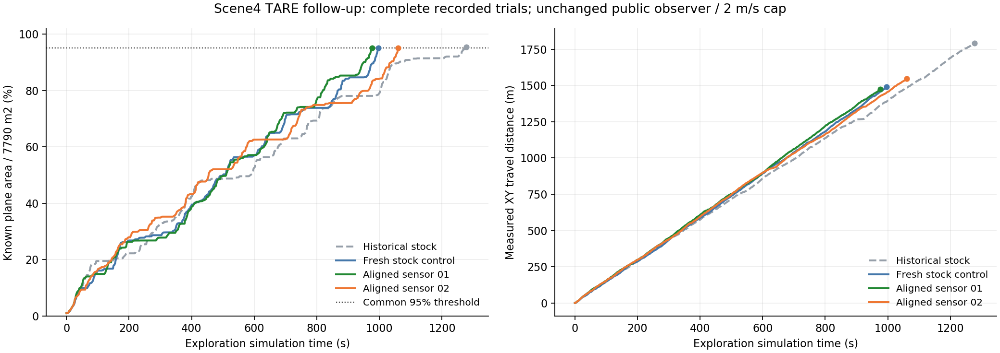

# TARE Scene4优化测试报告（2026-10-28）

**原配置新增完整对照为996.477s、1490.842m、95.0901%，健康和停车验收全部通过，未改算法便已接近论文时间。旧单次1277.279s的偏差不能直接认定为稳定性能差距或代码故障。本轮不采用感知模型对齐作为性能优化；修复候选和所有失败/不利观测保留。**

当前部署状态：已恢复并重建原生原配置，源码与程序SHA均匹配996.477秒新对照所用版本。GBP2后续测试继续暂停；既有四算法Scene4基线阶段完成记录保留。

## 全部正式观测与论文对照

| 版本/运行 | 时间(s) | 里程(m) | 覆盖指标 | 均速(m/s) | 结束/验收 |
|---|---:|---:|---:|---:|---|
| 论文Scene4（5次） | 1018.6±82.3 | 1640.0±135.3 | 未提供同口径比例 | 1.61 | 论文统计 |
| 历史原配置 `formal_tare_01` | 1277.279 | 1791.349 | 95.4023% | 1.402 | 95%完成，全部验收通过 |
| 新增原配置对照 `tare_audit_control_20261028_01` | 996.477 | 1490.842 | 95.0901% | 1.496 | 95%完成，全部验收通过 |
| 感知模型对齐01 `tare_sensor_model_20261028_01` | 976.461 | 1474.461 | 95.0757% | 1.510 | 95%完成，全部验收通过 |
| 感知模型对齐02 `tare_sensor_model_20261028_02` | 1060.356 | 1546.579 | 95.0223% | 1.459 | 95%完成，全部验收通过 |

[论文v4 Table I](https://arxiv.org/html/2412.13664v4)为五次统计；本表保留每次观测。本地时间和里程均为达到公共95%的探索段记录，含转向/等待，不含初始化及停车段。论文结束条件未核实与本地公共95%完全等价，因此数值接近只是描述性对照。若限时未达标，其时间和里程只代表限时窗口，不能参与“完成性能”均值。

原配置两次完成观测的描述性均值：时间1136.878±198.557s，里程1641.095±212.490m（样本Std，n=2）。原配置也有明显波动；不按最好一次替换历史基线，也不据此声称论文五次统计复现。

## 实际核对与改动

- 新对照原生二进制SHA与旧基线runtime_linkage.txt一致。公共观察器仍为已知平面面积/7790m²，阈值面积>7400.5m²，原生算法不读取该观察器作为探索目标。
- 运行参数核查：TARE感知规划范围12m，方向惯性关闭，公共localPlanner/pathFollower速度上限2m/s；没有提升速度上限、降低覆盖阈值或输入人工真值目标。
- 首先考虑过启用原生方向惯性，但观察中触发计数为0，且其代码只针对快速重复换向的relocation阶段，故该候选未启动；最初方案和改选理由保留。
- 实际VLP16垂直范围为±15°、16束；原TARE LiDARModel固定24°、12行，视点评估半视场12°。用实际原生类输入16束物理射线，旧版仅识别14束，±15°端点不可见。
- 候选仅对齐TARE原生垂直模型到30°，2°栅格包含两端点共16行，视点评估半视场15°且近场阈值使用同一斜率。两份原生源码和重建后的原生程序改变，其余公共执行代码及配置保持不变。相同实际类用例16/16通过，原生工作空间1包构建成功。
- 感知一致性修正是已验证的功能结果；它不是全部性能偏差的唯一根因证明，也不保证TSP路线更优。原生局部采样使用random_device，物理初始化位置亦有小量差异，本轮不是相同种子的配对因果试验。

## 与新对照的逐次差值

- tare_sensor_model_20261028_01：时间-2.01%，里程-1.10%（负值为减少，仅描述本轮观测）。
- tare_sensor_model_20261028_02：时间+6.41%，里程+3.74%（负值为减少，仅描述本轮观测）。

两轮对齐候选的描述性均值约1018.409s，虽然数值接近论文1018.6s，但其均值相对新原配置对照反而慢约2.20%、里程多约1.32%。不能按“更像论文均值”择优认定优化成功；观察到的稳定性能收益不足以支持采用。

## 实际记录曲线

末点补入原始result.json的实际结束时刻，避免1Hz日志最后一行低于95%而造成误读。曲线来自公共观察器，不是原生收益预测。

## 验证、数据与恢复

每次新图、1600s上限、统一协议修订3。完整主测试数据、原生路线/目标/速度独立订阅、运行配置/源码/二进制指纹、停车确认/零指令/漂移及按归属清理均按原始文件记录。接口健康通过与探索完成分开解释。

原始结果在D:/STGPlanner/benchmarks/results，各新目录不覆盖；原formal_tare_01仍保留。工作脚本codex/work/tare_optimization，原生变更before/after/patch及旧二进制在codex/outputs/tare_optimization_20261028/sensor_model_proposal。只有WSL /opt/stgplanner/benchmarks/tare_ws/src中的源码才进入原生构建，修改D盘上游克隆不会自动更新程序。

用例辅助构建曾遇pkg-config缺失和缺少原生misc_utils静态链接，调整后使用真实CMake头文件/链接设置；失败构建日志保留。这不是新算法长测失败，也未覆盖任何正式数据。

今后如恢复/重放，先读STATUS与仿真锁，核对实际进程；禁止重用旧运行名。restore_sensor_model.py只恢复源码，恢复后需原生重建并核对二进制SHA；已归档试验按其冻结版本解释。GBP2保持暂停，FAEL成功结果未重跑。

候选两次完成观测的描述性统计：时间1018.408±59.323s，里程1510.520±50.996m（样本Std，n=2）。
