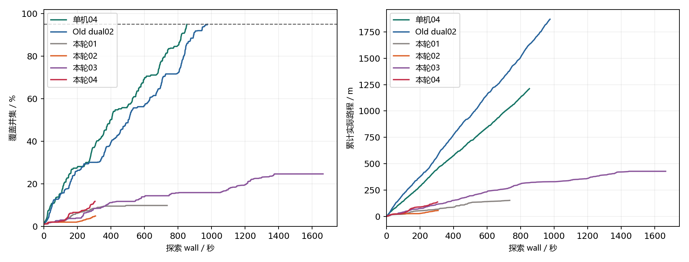
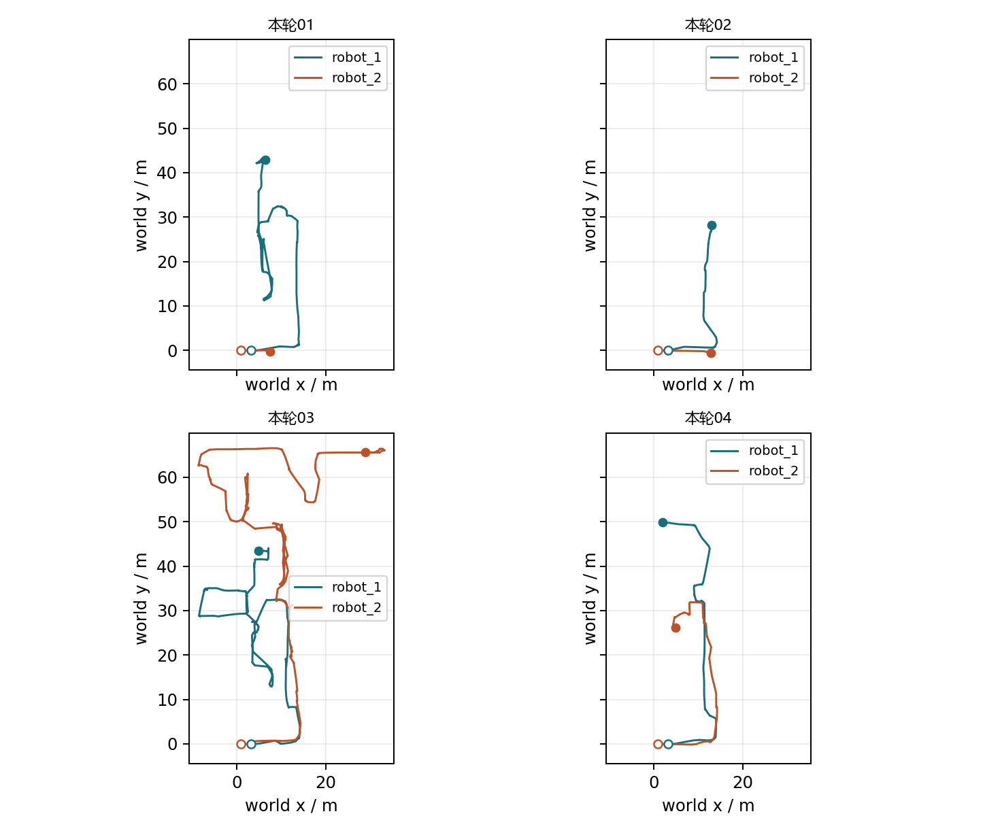

# Scene4 双机分支探索验证

共4次，最高覆盖为本轮03的24.616%。均未达到95%，没有可直接比较的达标耗时和达标路程。

沿用原Scene4和评分器，双车各自的0.4米评分格在world坐标中去重求面积。分母7790平方米，95%阈值7400.5平方米。普通平移上限2 m/s，转向上限π/3 rad/s。T95从进入探索起计，运行总wall还包含启动和停车收尾。

## 覆盖、耗时与路程

| 配置 | 结束方式 | 最终覆盖 | T95 wall（秒） | T95 sim（秒） | 探索wall（秒） | 总wall（秒） | 总路程（米） |
|---|---|---:|---:|---:|---:|---:|---:|
| 单机04 | 达标 | 95.053% | 853.085 | 805.116 | 853.086 | 927.285 | 1212.650 |
| Old dual02 | 达标 | 95.515% | 976.358 | 701.047 | 976.366 | 1069.668 | 1872.592 |
| 本轮01 | 覆盖停滞 | 9.779% | — | — | 735.881 | 814.070 | 151.961 |
| 本轮02 | 主动诊断收尾 | 4.825% | — | — | 308.906 | 393.878 | 55.828 |
| 本轮03 | 覆盖停滞 | 24.616% | — | — | 1665.453 | 1748.536 | 428.033 |
| 本轮04 | 车1规划器SIGSEGV | 12.235% | — | — | 306.074 | 393.704 | 137.795 |

Old dual02 为历史双车运行。未达标行的路程截止于实际结束。

## 定位与修改

旧第4次停滞段累计行驶60.717米，只新增一个评分格。该段17个派发继续访问相同或相邻入口，其中融合图通行获准2174次、本机接近带获准314次、原生前沿获准0次。离线重算仅给收益加权仍选原目标，引入已记录的失败入口后，约930秒车1改选图距离约16.6米的另一支路。离线重算输入是既有拓扑消息。

新代码按剩余信息和图距离选取分支，允许支撑匹配且入口接近的别名延续旧派发。对本机观测和有向通行进度做独立检查，绕圈或受阻入口在有限时间内降级。精选后撤视点仍须通过本机视线和车身扫掠。见 [实现与离线用例](BRANCH_REPAIR_20261118.md)。

## 执行证据

| 配置 | 冻结提交 | 任务切换STOP | 规划受阻STOP | 无进展STOP | 同时平移占比 | 双车停车ACK | 非地面接触 |
|---|---|---:|---:|---:|---:|---|---:|
| 本轮01 | `56519fc` | 14 | 23 | 0 | 0.83% | None / None | 0 |
| 本轮02 | `b7a7ff2` | 7 | 7 | 0 | 3.77% | True / True | 0 |
| 本轮03 | `f0fe6ec` | 43 | 45 | 3 | 14.94% | True / True | 0 |
| 本轮04 | `343b9c9` | 16 | 8 | 1 | 27.97% | True / True | 0 |

STOP按新nonce首次原因计数。两车测量速度绝对值同时超过0.05 m/s的有效同期采样计入平移。首跑原始ACK汇总为空，原始反馈独立保留两车最终nonce对应的速度门证明。

本轮03记录到连续图路前瞻获准944次。停稳超时复核记录为无对应采样。

本轮04记录到连续图路前瞻获准516次。停稳超时复核记录为无对应采样。

见 [第2版修改和验证依据](BRANCH_REPAIR_02_20261118.md)。

见 [第3版修改和验证依据](BRANCH_REPAIR_03_20261118.md)。

见 [第4版修改和验证依据](BRANCH_REPAIR_04_20261118.md)。

## 少新增覆盖时的行驶与到达

每30秒分段统计。单段两车累计行驶至少2米而并集只增加至多一个评分格（0.16平方米）时记入表中。分配期间从至少2米外到目标1.2米内，记为一次近入口到达。

| 配置 | 少增益分段数 | 段内总路程（米） | 双派发目标相距不足4米的采样 | 车1最大y（米） | 车2最大y（米） | 从至少2米外接近入口的次数（车1/车2，按入口去重） |
|---|---:|---:|---:|---:|---:|---|
| 上一轮parallel03 | 8 | 57.740 | 19/753 | 44.532 | 72.904 | 1/1 |
| 上一轮parallel04 | 13 | 102.317 | 251/856 | 32.522 | 46.960 | 3/2 |
| 本轮01 | 10 | 49.068 | 20/27 | 43.135 | 0.023 | 1/0 |
| 本轮02 | 0 | 0.000 | 19/19 | 28.180 | 0.017 | 1/0 |
| 本轮03 | 12 | 75.946 | 193/721 | 44.056 | 66.541 | 3/2 |
| 本轮04 | 0 | 0.000 | 96/242 | 49.870 | 31.860 | 0/0 |

按同一前300秒统计，第3次双路线目标不足4米的比例为192/267，第4次为96/237。同期少增益路程分别为4.468米和0.000米。第4次在约306秒中断，因此这项比较只覆盖共同前段。第3次在全程累计75.95米少增益行驶，长时间近墙无可执行局部路径的问题仍在。

探索wall约120.000秒的同期比较，取该时点前最后一条记录。

| 配置 | 采样wall（秒） | 覆盖 | 累计路程（米） |
|---|---:|---:|---:|
| 单机04 | 119.911 | 20.126% | 173.473 |
| Old dual02 | 119.115 | 15.702% | 241.448 |
| 前轮motion04 | 119.864 | 2.557% | 38.806 |
| 上一轮parallel03 | 119.615 | 2.001% | 23.230 |
| 上一轮parallel04 | 119.919 | 1.943% | 25.240 |
| 本轮01 | 119.846 | 2.434% | 27.025 |
| 本轮02 | 119.822 | 1.937% | 25.593 |
| 本轮03 | 119.997 | 2.943% | 49.394 |
| 本轮04 | 119.678 | 2.726% | 42.730 |

探索wall约853.085秒的同期比较，取该时点前最后一条记录。

| 配置 | 采样wall（秒） | 覆盖 | 累计路程（米） |
|---|---:|---:|---:|
| Old dual02 | 852.707 | 85.708% | 1631.619 |
| 前轮motion04 | 852.280 | 15.199% | 267.657 |
| 上一轮parallel03 | 852.970 | 12.921% | 250.585 |
| 上一轮parallel04 | 852.110 | 11.459% | 246.939 |
| 本轮03 | 852.953 | 15.832% | 319.549 |

探索wall约976.358秒的同期比较，取该时点前最后一条记录。

| 配置 | 采样wall（秒） | 覆盖 | 累计路程（米） |
|---|---:|---:|---:|
| 前轮motion04 | 976.143 | 19.233% | 318.128 |
| 上一轮parallel03 | 975.897 | 15.544% | 291.300 |
| 上一轮parallel04 | 975.415 | 11.461% | 286.292 |
| 本轮03 | 976.297 | 15.832% | 329.087 |

## 第4次原生退出

车1规划器退出139。用冻结的libtopo_planner.so符号化后，调用点落在 `applyExecutionRecovery` 遍历前沿时调用UFOMap坐标转换。恢复入口仍直接遍历定时更新的共享集合，通常的原生候选入口已有快照保护。本轮保留此失败和两车最终停驶回执。见 [堆栈定位](../evidence/branch_scene4_20261118/TRIAL04_NATIVE_DIAGNOSIS.md)。

## 数据核验

首跑确认GitHub上的 `56519fc`、冻结配置与部署指纹相符。末版离线通过168项Python和87项C++检查。四次都在2400秒内完成收尾。

核验了1391个新原始文件、36个冻结程序或库和1079项部署及历史指纹。历史账本、原基线和先前原始数据通过校验。结束后仿真进程与端口空闲。
