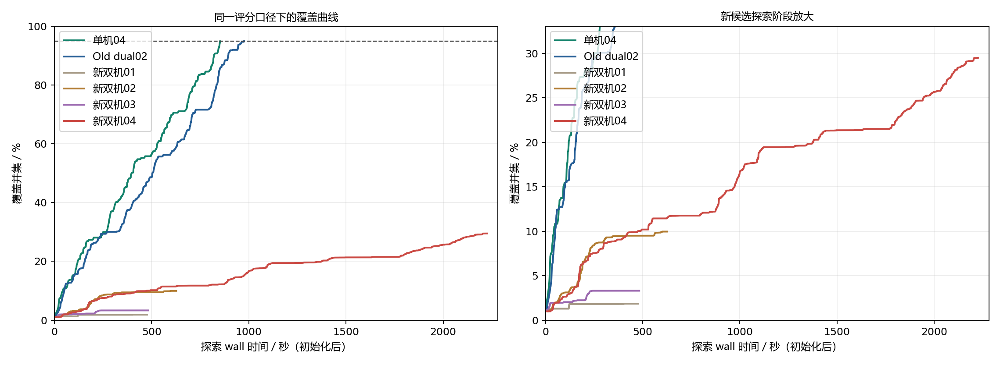
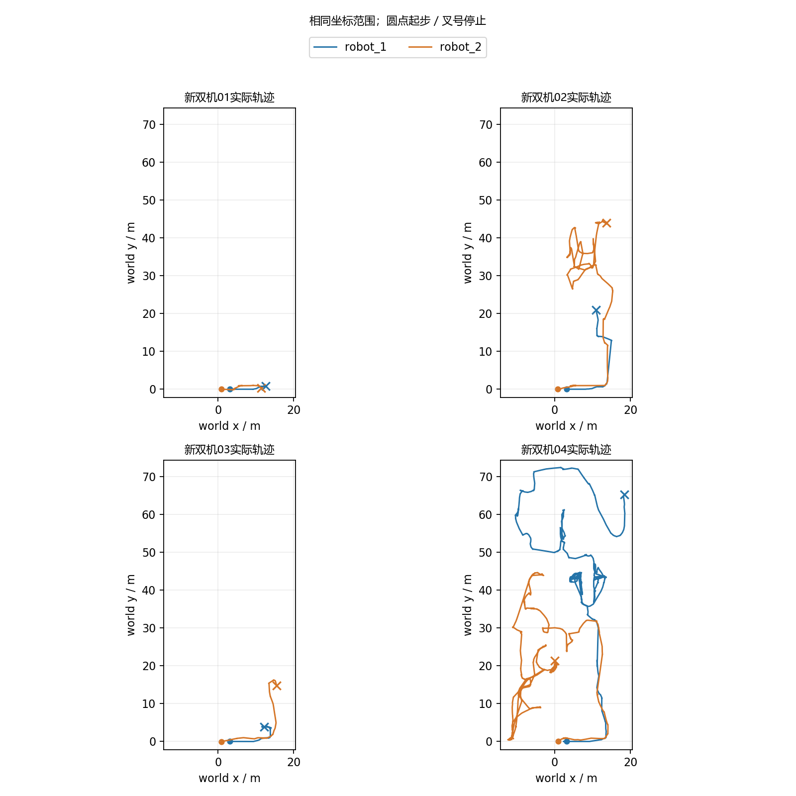

# 结论与对照

本轮4/4已结束关闭，**全部未达到两车覆盖并集95%，没有新的有效T95，不能证明比单机04或Old dual02更快、更好**。成功对照继续保留，新候选不晋升。

本轮针对真实失败证据修改了任务派发记忆、图更新处理、原生图内存安全、执行命令时序和同任务接近路线。**离线通过与短段运行健康不等于持续全空间探索通过。** 各次使用不同修订版，是有限工程诊断，不是同一算法的统计复现。

| 成功对照 | T95 wall / s | T95 sim / s | 达95%总路程 / m |
|---|---:|---:|---:|
| 单机04 | 853.085 | 805.116 | 1212.650 |
| Old dual02（双车） | 976.358 | 701.047 | 1872.592 |

| 本轮双车 | 最终并集 | 总wall含启动收尾 / s | 探索wall / s | 最终总路程 / m | T95 wall / s | 结束原因 | 最终双ACK |
|---|---:|---:|---:|---:|---:|---|---|
| 新双机01 | 1.842% | 558.004 | 476.599 | 26.940 | 未达到 | diagnostic_abort | 通过 |
| 新双机02 | 9.951% | 708.838 | 626.702 | 208.794 | 未达到 | diagnostic_abort | 通过 |
| 新双机03 | 3.301% | 562.904 | 482.525 | 65.769 | 未达到 | coverage_stagnation_240wall | 通过 |
| 新双机04 | 29.488% | 2311.067 | 2225.251 | 705.705 | 未达到 | wall_limit_including_startup | 通过 |

未达95%的短路程、提前结束wall不能与达95%的耗时／路程直接比较为效率提升。现有对照是历史单次成功记录，本轮未重跑它们。

# 实验条件与边界

- 同一Scene4、Jackal世界与底盘模型、原版独立评分器。相关世界／URDF／控制与评分配置SHA对照Old dual02核验。两车起点(0,0)/(-1.8,0)，初始化目标(3.5,0)/(1.2,0)，初始化限速0.6m/s，实际停靠姿态在原始result中。
- 普通平移上限2m/s，角速度上限π/3rad/s；短恢复0.2m/s、0.3rad/s。**上限一致，但跟踪控制律已修改，不是固定全部执行细节的纯分配消融。** 新原生为O2带符号RelWithDebInfo，成功对照为原构建；没有在线ASan或调试器。
- 完美通信、共同world与仿真真值定位。只交换拓扑／任务／执行和交通状态，本车占据建图独立；未接入跨车点云插入，也没有新增估计位姿回环优化。
- 评分0.4m格、12m观测范围、7790m²分母；面积`0.16×|U1∪U2|`，95%阈值7400.5m²。以各车独立原版评分CSV格ID求并集，重复观测不重复计分。评分不依赖规划任务的“完成”掩码。
- T95 wall从初始化与新栈验收完成、任务开始到首次95%的实际时间；sim为相同区间仿真时钟。总wall另含启动与收尾。最大4次且每次含启动收尾wall/sim≤2400s，启动失败／中止／崩溃均计数；覆盖停滞240wall可提前安全结束，不自动补跑。
- 总路程在探索active区间累计两车实际里程计位移；初始化和收尾停车漂移不混入探索路程。历史对照沿用相同active计数口径，停车漂移另列。

# 修复了什么，为什么修复

| 部分／代码 | 修改前的问题 | 本轮修改及保护边界 | 证据与限制 |
|---|---|---|---|
| `retry_memory.py`、`allocator.py`、`topology_coordinator.py` | 更换任务ID能绕过原单任务冷却；未交付意图提前占有任务 | 按本车起点0.75m与前1.5m方向记失败入口，15/30/45/60s退避；只有真正发出的ROUTE提交dispatched，未交付可重竞标 | 任务别名／反方向／另一车／提交屏障测试；不把不可执行或无人竞标当完成 |
| `allocator.py`执行者观测完成 | 同一world支撑换ID后可能再发 | 当前执行者完整观测证明保存跨ID完成支撑；新未知格仍保留；交接仍需旧车物理停车 | 完成别名与新增未知格回归；只适用静态共同world，不赋予自由／占据证据 |
| `graph.py` | 每条心跳深拷贝和摘要整张图，挤占反馈处理 | copy-on-write增量事务、live／边关联／作者索引、缓存摘要；改变节点重验旧关联边，原子失败不污染缓存 | 11107记录100心跳中位117.726ms→0.228ms、摘要一致；70条真实消息逐步结果一致；这是微基准，不是T95加速比 |
| `allocator.py`路径搜索 | 同轮竞标和路由重复最短路 | 每车一次Dijkstra结果供竞标和实际路径复用 | 图可达性／任务入口／旧拥有者测试通过；没有用欧氏直线代替可达距离 |
| `global_topo_manager.h/.cpp` | `vecS`图扩容使递归坐标引用失效；无有效骨架坐标、单子链循环／空子节点和索引上界隐患 | 坐标改值参数；无效输入早返回，历史链迭代与访问集；修正连接数赋值笔误和半开边界 | 采用实际STG图类型，旧写法ASan heap-use-after-free，新写法通过。**没有历史SIGSEGV调用栈，不能断言它是旧崩溃唯一原因** |
| `command_wait.h`、`topology_execution.cpp` | 目标跨action通道先到、对应命令订阅后到，误拒绝并触发STOP重派 | 独立action线程以steady_clock最多等待250ms，不持互斥锁；随后重验时间／租约／STOP；新STOP不会被旧ROUTE覆盖 | 第1次保存goal179/current178、同token、STOP=false的实证；5项时序／丢失／冻结时钟／新STOP测试 |
| `topology_bridge.cpp` | 任务约束合法的原生点路线仍可能整车不可执行 | 原生SE(2)无解时，只尝试同一任务已有图接近路线，仍用本车栅格与同车身余量／扫掠；不绕过DEFERRED_TASK | 4保存栅格／此前任务路线纯几何检查3成功1无解；未保存原生失败候选，不能称完整决策回放 |
| `execution.py`固定完成合同 | 第2次79派发中15个同代改变范围，最多11种digest、8→52格 | 冻结单次派发的scope／digest／成员，只刷新接近路径；新范围等下一代与物理STOP；深拷贝隔离 | 修改前回归失败、修改后通过，逐次在线变化数另列；不是把范围外未知当已探索 |
| `body_tracking.py`实测停稳 | 近墙停滞前存在尚有前进速度即旋转、转向残余未消即直行 | 原地转向前实测平移降至阈值，直行前实测转向残余消退；保持车身余量和正常上限 | 2个新增惯性用例及既有L形跟踪通过；物理模型仍有滑移／滞后，不宣称已消除近墙停滞 |
| `body_route.h`净空优先（第4次） | 原0.15m规划余量在执行惯性／跟踪偏差后可能不足 | 起点允许时先尝试0.22m规划扫掠，再回退原0.15m搜索；执行仍0.15m、恢复0.05m，原可行路线不被额外硬阈值删除 | 新增较大净空认证与1m窄道回退用例；每次bodyRoute两阶段合计最多3200扩展，真实耗时另核验，不承诺实际跟踪全程0.22m |
| 试验隔离／健康监视 | 原生SIGSEGV可导致整栈及里程计退出，无法完成停车验收 | 保留原生PID启动时间健康监视、致命栈日志、planner退出隔离、新鲜里程计STOP证明、接触监视 | 沿用上轮诊断保护；最终ACK与接触逐次单独报告，没有用静止替代ACK |

# 图队列、原生进程与执行证据

| 次数 | 最大图应用 / ms | 最大反馈排队 / ms | 最大协调分配计算 / ms | 最大拓扑待处理条数 | 过期源状态采样 | 保存SIGSEGV日志行数 |
|---|---:|---:|---:|---:|---:|---:|
| 01 | 4.02 | 30.76 | 26.70 | 1 | 0 | 0 |
| 02 | 119.75 | 206.41 | 245.13 | 2 | 0 | 0 |
| 03 | 30.81 | 55.54 | 63.04 | 1 | 0 | 0 |
| 04 | 291.38 | 907.61 | 940.61 | 4 | 0 | 0 |

过期源状态仍会安全停车，没有放宽新鲜性门槛。ACK审计拒绝数包含已经stopped状态的重复证明；应结合fault阶段与最终nonce证明判断，不能直接当作停车失败数。无新崩溃只代表这些有限运行未观察到，不能证明原生规划器不存在其他内存缺陷。

第4次按唯一STOP nonce首次原因还记录了**2次COORDINATOR_TIMEOUT**，即执行侧协调命令租约过期；它与STOP/ACK停车证明超时不同。最大单轮协调分配计算940.61ms、反馈排队907.61ms说明实时开销尚未闭环；这些是团队协调器统计，不是原生STG局部搜索耗时，不能因没有源状态过期/fault采样就称通信与控制时序全部正常。后续应将昂贵图／分配计算与当前合同心跳分离，仍由唯一归属权威串行提交新任务和STOP/ACK，保留陈旧计划拒绝与本车安全门控；这是后续设计建议，本轮没有实施。

### 第01次

- 任务实际派发代数：{'robot_1': 13, 'robot_2': 12}；不同任务：{'robot_1': 6, 'robot_2': 5}；STOP nonce：{'robot_1': 15, 'robot_2': 13}。计数不是完成任务数，也不把心跳消息数当重派次数。
- 同version/dispatch范围变化：1/25个派发。实测惯性停稳门控采样：[]。
- 执行拒绝类别：{'stop_pending': 12, 'same_token_goal_ahead_without_stop': 1}。STOP_pending拒绝可能是正确阻挡旧目标；不能把所有拒绝都计为新故障。
- 路线反馈：DEFERRED_TASK/BLOCKED=2；FUSED_GRAPH_TRANSIT/ACCEPTED=759；NATIVE_TASK_STATES/ACCEPTED=482；NATIVE_TASK_STATES/BLOCKED=12；None/OBSERVATION_COMPLETED=3。ACCEPTED只表示当前本车前缀通过，不能当作执行或完成。
- 原生状态访问：{'1': 1255, '3': 1239, '4': 1242, '5': 494, '2': 2}。没有某状态的访问不等于测试强行补齐。
- 本车CSV面积：{'robot_1': 143.36, 'robot_2': 113.12}，去重并集143.52m²，核对result一致。
- 非running输出运动样本0、过期地图输出运动样本0、低速恢复超限样本0；这是已记录采样审计，不是连续时间形式证明。
- 最后0.1m圆盘内静止段：robot_1 73.393s内1任务/1派发；robot_2 4.277s内1任务/1派发。
- 非地面接触0条；最终停车ACK {'robot_1': True, 'robot_2': True}，2秒漂移{'robot_1': 0.0001895881836431239, 'robot_2': 2.6248557995108637e-06}。

两车共同观测交集112.96m²，占已覆盖并集的78.71%；这是空间观测重叠，不是重复行驶里程。规划扫掠方法反馈（消息数，不是完成路段数）：[{'method': 'RECENTER_ROTATE', 'status': 'ACCEPTED', 'messages': 44}, {'method': 'RECENTER_STRAIGHT', 'status': 'ACCEPTED', 'messages': 11}, {'method': 'SE2', 'status': 'ACCEPTED', 'messages': 1186}, {'method': 'SE2', 'status': 'BLOCKED', 'messages': 14}]。

按唯一nonce的首次原因统计STOP：{'bootstrap': 2, 'assignment_changed': 3, 'planner_blocked': 13, 'EXECUTOR_STOP': 1, 'observation_completed': 2, 'TRAFFIC_WAIT_REPLAN': 5, 'execution': 2}。连续派发诊断：{'task_id_changes': 12, 'changed_id_support_overlap_ge_half': 3, 'changed_id_overlap_ge_half_same_ingress': 2}。未知支撑重叠／入口相似只是排查线索，不能未经自由空间连通性验证就合并墙两侧任务。

### 第02次

- 任务实际派发代数：{'robot_1': 32, 'robot_2': 47}；不同任务：{'robot_1': 29, 'robot_2': 28}；STOP nonce：{'robot_1': 34, 'robot_2': 49}。计数不是完成任务数，也不把心跳消息数当重派次数。
- 同version/dispatch范围变化：15/79个派发。实测惯性停稳门控采样：[]。
- 执行拒绝类别：{'stop_pending': 17}。STOP_pending拒绝可能是正确阻挡旧目标；不能把所有拒绝都计为新故障。
- 路线反馈：DEFERRED_TASK/ACCEPTED=2；DEFERRED_TASK/BLOCKED=32；FUSED_GRAPH_TRANSIT/ACCEPTED=2166；FUSED_GRAPH_TRANSIT/BLOCKED=21；FUSED_TRANSIT_NATIVE_INFEASIBLE/ACCEPTED=115；NATIVE_TASK_STATES/ACCEPTED=1181；NATIVE_TASK_STATES/BLOCKED=8；None/OBSERVATION_COMPLETED=14。ACCEPTED只表示当前本车前缀通过，不能当作执行或完成。
- 原生状态访问：{'1': 3525, '3': 2771, '4': 4006, '5': 1839, '2': 3}。没有某状态的访问不等于测试强行补齐。
- 本车CSV面积：{'robot_1': 289.44, 'robot_2': 775.04}，去重并集775.20m²，核对result一致。
- 非running输出运动样本0、过期地图输出运动样本0、低速恢复超限样本0；这是已记录采样审计，不是连续时间形式证明。
- 最后0.1m圆盘内静止段：robot_1 66.212s内1任务/1派发；robot_2 3.227s内1任务/1派发。
- 非地面接触0条；最终停车ACK {'robot_1': True, 'robot_2': True}，2秒漂移{'robot_1': 0.006877511810598219, 'robot_2': 0.00029370907570684744}。

两车共同观测交集289.28m²，占已覆盖并集的37.32%；这是空间观测重叠，不是重复行驶里程。规划扫掠方法反馈（消息数，不是完成路段数）：[{'method': 'RECENTER_ROTATE', 'status': 'ACCEPTED', 'messages': 217}, {'method': 'RECENTER_STRAIGHT', 'status': 'ACCEPTED', 'messages': 12}, {'method': 'SE2', 'status': 'ACCEPTED', 'messages': 3235}, {'method': 'SE2', 'status': 'BLOCKED', 'messages': 61}]。

按唯一nonce的首次原因统计STOP：{'bootstrap': 2, 'assignment_changed': 33, 'observation_completed': 10, 'planner_blocked': 36, 'execution': 2}。连续派发诊断：{'task_id_changes': 75, 'changed_id_support_overlap_ge_half': 18, 'changed_id_overlap_ge_half_same_ingress': 3}。未知支撑重叠／入口相似只是排查线索，不能未经自由空间连通性验证就合并墙两侧任务。

### 第03次

- 任务实际派发代数：{'robot_1': 19, 'robot_2': 17}；不同任务：{'robot_1': 15, 'robot_2': 12}；STOP nonce：{'robot_1': 20, 'robot_2': 19}。计数不是完成任务数，也不把心跳消息数当重派次数。
- 同version/dispatch范围变化：0/36个派发。实测惯性停稳门控采样：[{'robot': 'robot_1', 'reason': 'BRAKE_BEFORE_TURN', 'samples': 859}, {'robot': 'robot_1', 'reason': 'SETTLE_BEFORE_TRANSLATION', 'samples': 114}, {'robot': 'robot_2', 'reason': 'BRAKE_BEFORE_TURN', 'samples': 573}, {'robot': 'robot_2', 'reason': 'SETTLE_BEFORE_TRANSLATION', 'samples': 165}]。
- 执行拒绝类别：{'stop_pending': 8}。STOP_pending拒绝可能是正确阻挡旧目标；不能把所有拒绝都计为新故障。
- 路线反馈：DEFERRED_TASK/BLOCKED=3；FUSED_GRAPH_TRANSIT/ACCEPTED=1009；FUSED_GRAPH_TRANSIT/BLOCKED=9；FUSED_TRANSIT_NATIVE_INFEASIBLE/ACCEPTED=122；NATIVE_TASK_STATES/ACCEPTED=1195；NATIVE_TASK_STATES/BLOCKED=2；None/OBSERVATION_COMPLETED=4。ACCEPTED只表示当前本车前缀通过，不能当作执行或完成。
- 原生状态访问：{'1': 2340, '2': 2, '5': 1332, '3': 2140, '4': 2258}。没有某状态的访问不等于测试强行补齐。
- 本车CSV面积：{'robot_1': 174.24, 'robot_2': 256.32}，去重并集257.12m²，核对result一致。
- 非running输出运动样本0、过期地图输出运动样本0、低速恢复超限样本0；这是已记录采样审计，不是连续时间形式证明。
- 最后0.1m圆盘内静止段：robot_1 3.204s内1任务/1派发；robot_2 227.193s内2任务/6派发。
- 非地面接触0条；最终停车ACK {'robot_1': True, 'robot_2': True}，2秒漂移{'robot_1': 8.356453152578014e-05, 'robot_2': 3.303952201644362e-05}。

两车共同观测交集173.44m²，占已覆盖并集的67.45%；这是空间观测重叠，不是重复行驶里程。规划扫掠方法反馈（消息数，不是完成路段数）：[{'method': 'RECENTER_ROTATE', 'status': 'ACCEPTED', 'messages': 115}, {'method': 'RECENTER_STRAIGHT', 'status': 'ACCEPTED', 'messages': 24}, {'method': 'SE2', 'status': 'ACCEPTED', 'messages': 2187}, {'method': 'SE2', 'status': 'BLOCKED', 'messages': 14}]。

按唯一nonce的首次原因统计STOP：{'bootstrap': 2, 'assignment_changed': 14, 'observation_completed': 4, 'planner_blocked': 12, 'TRAFFIC_WAIT_REPLAN': 1, 'EXECUTION_STALL': 3, 'EXECUTION_DEADLINE': 1, 'EXECUTOR_STOP': 1, 'execution': 1}。连续派发诊断：{'task_id_changes': 27, 'changed_id_support_overlap_ge_half': 6, 'changed_id_overlap_ge_half_same_ingress': 1}。未知支撑重叠／入口相似只是排查线索，不能未经自由空间连通性验证就合并墙两侧任务。

### 第04次

- 任务实际派发代数：{'robot_1': 126, 'robot_2': 127}；不同任务：{'robot_1': 75, 'robot_2': 62}；STOP nonce：{'robot_1': 127, 'robot_2': 129}。计数不是完成任务数，也不把心跳消息数当重派次数。
- 同version/dispatch范围变化：0/253个派发。实测惯性停稳门控采样：[{'robot': 'robot_1', 'reason': 'BRAKE_BEFORE_TURN', 'samples': 10905}, {'robot': 'robot_1', 'reason': 'SETTLE_BEFORE_TRANSLATION', 'samples': 2195}, {'robot': 'robot_2', 'reason': 'BRAKE_BEFORE_TURN', 'samples': 9813}, {'robot': 'robot_2', 'reason': 'SETTLE_BEFORE_TRANSLATION', 'samples': 1970}]。
- 执行拒绝类别：{'stop_pending': 88, 'same_token_goal_ahead_without_stop': 6}。STOP_pending拒绝可能是正确阻挡旧目标；不能把所有拒绝都计为新故障。
- 路线反馈：DEFERRED_TASK/BLOCKED=240；FUSED_GRAPH_TRANSIT/ACCEPTED=7704；FUSED_GRAPH_TRANSIT/BLOCKED=66；FUSED_TRANSIT_NATIVE_INFEASIBLE/ACCEPTED=561；NATIVE_TASK_STATES/ACCEPTED=10397；NATIVE_TASK_STATES/BLOCKED=8；None/OBSERVATION_COMPLETED=72。ACCEPTED只表示当前本车前缀通过，不能当作执行或完成。
- 原生状态访问：{'1': 18976, '3': 14349, '4': 20623, '5': 13296, '2': 15}。没有某状态的访问不等于测试强行补齐。
- 本车CSV面积：{'robot_1': 1481.28, 'robot_2': 1369.44}，去重并集2297.12m²，核对result一致。
- 非running输出运动样本0、过期地图输出运动样本0、低速恢复超限样本0；这是已记录采样审计，不是连续时间形式证明。
- 最后0.1m圆盘内静止段：robot_1 0.000s内0任务/0派发；robot_2 32.590s内3任务/3派发。
- 非地面接触0条；最终停车ACK {'robot_1': True, 'robot_2': True}，2秒漂移{'robot_1': 0.00014332498045233546, 'robot_2': 0.0002822460430939481}。

两车共同观测交集553.60m²，占已覆盖并集的24.10%；这是空间观测重叠，不是重复行驶里程。规划扫掠方法反馈（消息数，不是完成路段数）：[{'method': 'CLEARANCE_SE2', 'status': 'ACCEPTED', 'messages': 17499}, {'method': 'RECENTER_ROTATE', 'status': 'ACCEPTED', 'messages': 157}, {'method': 'RECENTER_STRAIGHT', 'status': 'ACCEPTED', 'messages': 15}, {'method': 'SE2', 'status': 'ACCEPTED', 'messages': 991}, {'method': 'SE2', 'status': 'BLOCKED', 'messages': 314}]。

按唯一nonce的首次原因统计STOP：{'bootstrap': 2, 'assignment_changed': 78, 'observation_completed': 32, 'EXECUTOR_STOP': 8, 'planner_blocked': 98, 'EXECUTION_STALL': 23, 'EXECUTION_DEADLINE': 12, 'COORDINATOR_TIMEOUT': 2, 'execution': 1}。连续派发诊断：{'task_id_changes': 243, 'changed_id_support_overlap_ge_half': 39, 'changed_id_overlap_ge_half_same_ingress': 6}。未知支撑重叠／入口相似只是排查线索，不能未经自由空间连通性验证就合并墙两侧任务。

# 相同120秒探索wall的辅助比较

各取不超过120秒的最后一个实测采样；这是早期进展对比，不是T95替代品。若试验未运行到120秒，则不加入。

| 配置 | 实际采样探索wall / s | 覆盖并集 | 累计总路程 / m |
|---|---:|---:|---:|
| 单机04 | 119.911 | 20.126% | 173.473 |
| Old dual02 | 119.115 | 15.702% | 241.448 |
| 新双机01 | 119.992 | 1.284% | 22.250 |
| 新双机02 | 119.265 | 3.114% | 63.380 |
| 新双机03 | 119.405 | 2.025% | 29.943 |
| 新双机04 | 119.899 | 2.939% | 46.974 |

最新双机在约120秒内累计只走了46.974米；单机04为173.473米，Old dual02为241.448米。实际推进速度明显更低，不能把性能差距只归因于任务分配或地图去重。速度上限相同不等于实际均速相同，当前执行／滚动路径／停转闭环仍需优先处理。

# 尚未解决的验收与下一步

**验收发现：PASS交通许可可能覆盖当前局部零速度意图，尚未修复。** 冻结第4次纯Python函数检查（无ROS／仿真／原生重放）中，`TrafficGuard.filter`收到当前零速度、同token且新鲜的PASS速度(1,0)，返回(1,0)。它直接替换输入速度，因此BRAKE_BEFORE_TURN／SETTLE_BEFORE_TRANSLATION的零意图可能被较早审批恢复。实际trace也保存了零proposal、非零output及附近PASS状态。

| 次数 | 零proposal／非零output，关联最后PASS状态的采样数 |
|---|---:|
| 01 | 0 |
| 02 | 1 |
| 03 | 254 |
| 04 | 4393 |

这是采样关联，附近交通status不是逐门控审批的精确送达时刻；代码纯函数反例独立证实语义缺陷。RETREAT允许经单独认证的退让，不混作PASS问题。**这不表示任务STOP/ACK屏障被绕过**：非running阶段仍强制零，末端占据／新鲜性／制动扫掠仍检查实际输出；但运行中局部制动意图的优先级不完整，不能把新增停稳意图说成真实物理停稳保证。该问题在第4次运行验收才确认，本轮次数已满，未改算法或补跑。

后续优先让PASS审批只约束当前请求，绑定请求序号并保证当前停止／转向阻断立即占优；RETREAT走独立、明确授权和本车扫掠验证的通道。之后再检验近墙转向、短前缀滚动重置和任务分支往返的进展反馈，不能只重置任务ID或只看0.1m累计位移。

**另一处剩余问题：已收到的其他车观测完成摘要，没有充分进入跨ID的全队完成掩码。** 目前掩码只由当前任务执行者的OBSERVATION_COMPLETED反馈扩充；作者在图记录中发布的`completed/all_previous_unknown_observed`任务会从自身候选中消失，但相应支撑没有自动用于消除另一个来源的残留未知任务。两车地图独立时，这可能保留已被另一车观测的任务，形成跟随式重复。

对各车最后保存full JSON作纯图校验和支撑统计（无ROS／原生重放）：

| 次数 | 作者已报告观测完成的支撑并集／格 | 协调器执行者完成掩码／格 | 至少未进入掩码的报告支撑／格 |
|---|---:|---:|---:|
| 01 | 200 | 100 | 100 |
| 02 | 2392 | 384 | 2008 |
| 03 | 548 | 356 | 192 |
| 04 | 7742 | 1542 | 6200 |

末列只用集合大小下界`max(0,报告并集大小−掩码大小)`，full快照可能早于最终status；不是额外评分覆盖面积，也不是已经验证的效率收益。当前来源证据与执行者证据用途尚未统一，这是代码和数据支持的待修复方向，不能把所有重复探索都归因于它。后续应允许任何车的有效观测摘要更新“区域是否已观测”，同时让“谁有权执行”继续等待旧拥有者物理STOP/ACK；无需因此恢复全量点云传输。该改动本轮未实施。

空间退避减少重复尝试的机会，同时可能让机器人在可用入口不足时等待；不自动产生新的可通行路线。全局图的可达路径由点／栅格连接组成，整车转向仍可能失败，局部路径通过也可能在滚动重规划时停滞。任务完成反馈、跨来源任务别名与几何连通性仍会影响任务数量和分工；观察到两车进入相似通道不能据此称已避免跟随式重复探索。最终覆盖、停滞段、派发代数和路线反馈如上，没有用低接触／低队列延迟代替覆盖闭环。

`reachable_groups`诊断已叠加任务退避和失败入口屏蔽，数值0不等于拓扑图物理断连。第4次保存的待命现场，本车0.20m车身余量仍自由，需结合实际BLOCKED原因和入口记忆判断。固定同代scope也没有消除不同任务ID之间的切换；今后需核验未知支撑与自由连通分量的稳定关联，不能只靠任务更名或粗暴放宽退避。图接收的纯心跳缓存也不覆盖不断变化的几何路径／大图分配开销；在线最大耗时如上，尚未实现DTW／主干路径去冗余。

后续应先用本轮保存的失败栅格、租约和路径定位不可执行／执行停滞原因，完善有界的同任务进展机制，再在新的明确有限授权内验证全空间95%。本轮额度关闭后不继续算法修改、启动新仿真或原生地图重放。成功单机04／Old dual02继续保留，不默认替换。

# 验证、版本与保全

第1次前112 Python与59 C++断言；第2次前112 Python与64 C++断言；第3次前117 Python与64 C++断言；第4次前117 Python与66 C++断言（ASan/UBSan）通过。任务范围与惯性新增回归在旧实现出现4个失败，修复后全部通过。值坐标回归使用实际STG图类型；旧引用写法预期失败的ASan日志保留。图差分／微基准／保存栅格几何检查都未启动ROS／Gazebo或原生地图重放。最终离线日志为offline_05，部署与实际运行程序按各次manifest核验。

| 次数 | 冻结算法提交 | 本次编译源文件数 | 归档程序／库 |
|---|---|---:|---:|
| 01 | [231f91c](https://github.com/y-ii-ii/STGPlanner-reproduction/commit/231f91c05e0a43767658748dbced2a693e3ff432) | 131 | 9 |
| 02 | [e6fee0d](https://github.com/y-ii-ii/STGPlanner-reproduction/commit/e6fee0d22e4359134d085e89594686001e0715c1) | 132 | 9 |
| 03 | [719984e](https://github.com/y-ii-ii/STGPlanner-reproduction/commit/719984e284e18371155655683eafc0f67cd31bc2) | 133 | 9 |
| 04 | [b4ab2a8](https://github.com/y-ii-ii/STGPlanner-reproduction/commit/b4ab2a8b9566505f3f344f7f7cb73ab9e035346a) | 133 | 9 |

各次冻结源码／配置和程序SHA均保存，原始数据不覆盖。原主Git仍干净；181个保护文件、12823项旧历史元数据、交通990／近墙1157／上一轮派发1221个原始文件SHA、92个旧归档程序、新36个归档程序核验。新原始1293文件SHA保存。638项当前部署与旧保护指纹一致，其中旧保护505项；主Git与旧scope不变。ROS/Gazebo与11311/11312/11345空闲，锁idle，本轮closed。

报告：`codex/outputs/Scene4跨任务重派图积压与原生内存修复验证报告_20261117.md/.html`。证据：`codex/work/topology_liveness_20261117`，Git内`multi_robot/evidence/liveness_scene4_20261117`。原始数据：`benchmarks/results/topology_liveness_scene4_20261117_*_dual`。权威次数：`codex/TOPOLOGY_LIVENESS_LIMITS_20261117.json`。代码注释和方法说明：`multi_robot/docs/LIVENESS_REPAIR_20261117.md`。
