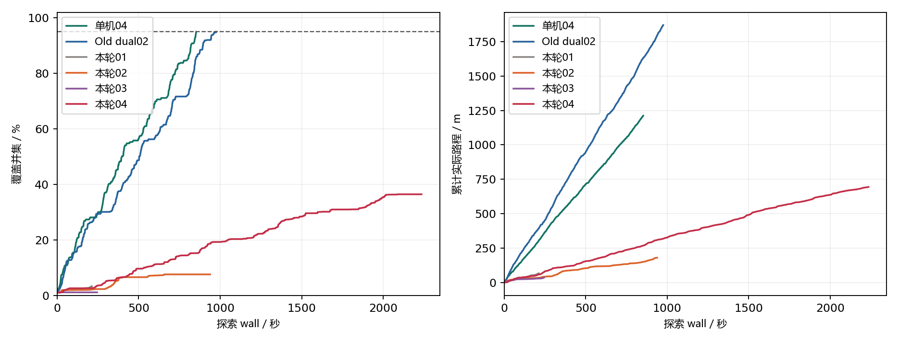

# Scene4 双机前沿崩溃修复与实际推进验证

本轮未达到95%覆盖。修复后最高覆盖来自本轮04，为 36.416%（2836.80 m²）。单机04和Old dual02均达到95%，新配置没有可直接对比的T95或达标总路程。 修复后三次在约120秒时的最高推进率为 0.324 m/wall-s，仍低于两个已达标的对照。

## 测试条件

Scene4、世界坐标系、原世界与评分器、普通平移上限2 m/s、转向上限π/3 rad/s。两车各自的0.4 m评分格按坐标去重求并集，评分分母7790 m²，95%对应7400.5 m²。T95从完成初始化、开始探索后计时。总 wall 包含初始化、探索与收尾。停止前累计实际里程计路程列为总路程。

本轮共计 4 次（上限4），含首轮原生崩溃。所有计入的试验 wall 和 sim 时长均在2400秒以内。

## 覆盖与耗时

| 配置 | 结束原因 | 终止覆盖 | 总 wall / s | 探索 wall / s | T95 wall / s | T95 sim / s | 总路程 / m |
|---|---|---:|---:|---:|---:|---:|---:|
| 单机04 | 达到阈值 | 95.053% | 927.285 | 853.086 | 853.085 | 805.116 | 1212.650 |
| Old dual02 | 达到阈值 | 95.515% | 1069.668 | 976.366 | 976.358 | 701.047 | 1872.592 |
| 本轮01 | 原生进程退出 | 3.329% | 297.570 | 213.608 | — | — | 67.992 |
| 本轮02 | 覆盖停滞 | 7.560% | 1019.719 | 938.937 | — | — | 180.344 |
| 本轮03 | 覆盖停滞 | 1.099% | 327.898 | 245.269 | — | — | 36.709 |
| 本轮04 | wall限时 | 36.416% | 2311.989 | 2235.347 | — | — | 694.724 |

未达标试次的总路程只覆盖已完成的探索部分。

## 实际推进速度

取探索 wall 120秒前最后一个采样点。推进率为累计路程除以采样 wall，单位为 m/wall-s，双机值是两车之和。该指标包含等待、转向和计算开销。

| 配置 | 采样 wall / s | 覆盖 | 累计路程 / m | 推进率 / m/wall-s |
|---|---:|---:|---:|---:|
| 单机04 | 119.911 | 20.126% | 173.473 | 1.447 |
| Old dual02 | 119.115 | 15.702% | 241.448 | 2.027 |
| 上一轮04 | 119.899 | 2.939% | 46.974 | 0.392 |
| 本轮01 | 119.579 | 2.247% | 35.711 | 0.299 |
| 本轮02 | 119.596 | 1.959% | 29.219 | 0.244 |
| 本轮03 | 119.983 | 1.089% | 24.578 | 0.205 |
| 本轮04 | 119.864 | 2.557% | 38.806 | 0.324 |

全段平移占比来自本车里程计，阈值为绝对平移速度>0.05 m/s。仅统计相邻且间隔≤250 ms的样本，按实际采样 wall 加权。

| 配置 | 车1平移占比 | 车2平移占比 | 全段推进率 / m/wall-s | 作者证书新增格 | 最大续租发布间隔 / s | 协调租约超时 STOP 数 | 来源状态过期采样数 |
|---|---:|---:|---:|---:|---:|---:|---:|
| 本轮01 | 56.2% | 55.6% | 0.318 | 468 | 0.142 | 0 | 0 |
| 本轮02 | 44.9% | 19.4% | 0.192 | 1632 | 0.213 | 0 | 83 |
| 本轮03 | 30.6% | 27.3% | 0.150 | 0 | 0.111 | 0 | 0 |
| 本轮04 | 57.7% | 56.0% | 0.311 | 8739 | 0.603 | 0 | 0 |

第2次车2有长时间无法分配可达任务。保存的本机位姿与执行栅格快照显示该停驻处连零额外余量的车身自由检查也失败。日志随后记录落点自由格校验拒绝，拓扑流过期触发安全停车。本次采到 83 条来源过期状态，另有 40 个以任务变更为首因的STOP nonce。恢复后两车仍有实际位移，但覆盖在588.96 m²附近停滞。

第3次在起始通道反复让行，两车分别采到 2142 和 2992 条HOLD交通状态。曾出现一车HOLD、另一车PASS按0.1倍速度获批的时段，最终覆盖停滞。

第4次两车分别累计 323.655 米和 371.069 米。约120秒时累计路程38.806米，低于上一轮04的46.974米。全段探索 wall 为 2235.347 秒，覆盖较上一轮04提高6.928个百分点，三次复测之间波动明显。
第4次有 119 个任务变更STOP 和 59 个规划受阻STOP。协调分配最长单轮 1.361 秒，续租实际发布最大间隔 0.603 秒。证书累计新增 8739 个观测支撑格。支撑格用于任务去重，评分并集仍来自独立评分器。

## 崩溃修复与证据

首轮车2规划器退出139。归档运行库的符号化调用栈定位到 `HeriGraphCoverPlanner::getSuitableTourPoints` 读取前沿 `Code` 并调用 UFOMap `toCoord`。定时更新会清空或替换集合，与规划动作线程同时遍历时可能留下悬空引用。实项目类型的离线 ASan 测试复现了旧引用在擦除后继续转换的故障。

修复用同一互斥锁保护写入和两组前沿的值快照。坐标转换前检查深度上界，规划从快照读取。通过134项Python测试、70项C++检查、独立构建和源码/运行库指纹核验。

修复后 3/3 次试验未因原生进程退出而结束。这个结果覆盖本轮实测时长。

| 配置 | 冻结提交 | 最终两车停止ACK | 接触监视在线 | 非地面接触记录 |
|---|---|---|---|---:|
| 本轮01 | `1cf8a23` | True / True | True | 0 |
| 本轮02 | `7d6c4ee` | True / True | True | 0 |
| 本轮03 | `7d6c4ee` | True / True | True | 0 |
| 本轮04 | `7d6c4ee` | True / True | True | 0 |

本轮首版引入的PASS限幅、作者观测证书和已提交合同续租继续使用。证书只影响信息需求去重，交接仍依据旧车物理STOP/ACK。推进率、平移占比和覆盖曲线反映完整控制链，无法单独归因于分配或前沿集合修复。

## 数据保全

核验了本轮 1319 个原始文件、36 个归档程序或库，以及 782 项部署和历史保护指纹。第1次失败的326个文件与修复前校验清单一致，旧基线与旧轮次账本均通过比对。
