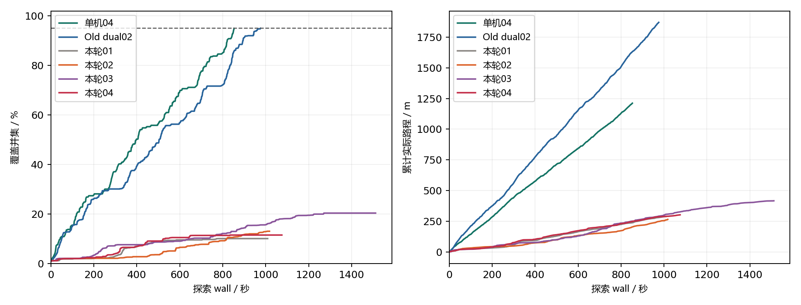

# Scene4 双机同时推进验证

完成4次，最高并集来自本轮03，为20.323%（1583.20 m²）。各次均未达到95%，未获得可与两个成功基线直接比较的T95及达标路程。

本轮全程同时平移比例最高为本轮01的30.34%，上一轮04为32.38%。

试验沿用同一Scene4、原评分器与0.4 m格。两车独立评分格以世界坐标求并集，分母7790 m²，95%阈值7400.5 m²。普通平移上限2 m/s，转向上限π/3 rad/s。T95从探索开始计时，总wall含启动及收尾。

## 覆盖、耗时与路程

| 配置 | 结束原因 | 最终覆盖 | 总wall / s | 探索wall / s | T95 wall / s | T95 sim / s | 总路程 / m |
|---|---|---:|---:|---:|---:|---:|---:|
| 单机04 | 达标 | 95.053% | 927.285 | 853.086 | 853.085 | 805.116 | 1212.650 |
| Old dual02 | 达标 | 95.515% | 1069.668 | 976.366 | 976.358 | 701.047 | 1872.592 |
| 本轮01 | 诊断中止 | 10.025% | 1090.509 | 1009.429 | — | — | 288.819 |
| 本轮02 | 诊断中止 | 12.991% | 1093.761 | 1017.865 | — | — | 265.145 |
| 本轮03 | 覆盖停滞 | 20.323% | 1592.191 | 1512.276 | — | — | 416.688 |
| 本轮04 | 覆盖停滞 | 11.461% | 1158.464 | 1076.185 | — | — | 302.682 |

未达标行的路程只对应已完成的探索部分。

第1次在超过两条成功对照的T95后覆盖增长接近停住。第2次在同一时点覆盖仍明显低于对照。两次均在探索约1000秒时主动诊断收尾，保留该时点前的完整时间轴。

## 同时推进与停止原因

按两车同期里程计采样估算平移重叠。两车绝对平移速度均超过0.05 m/s才计入。采样间隔和两车数据年龄均不超过250 ms。等待和原地转向不计入平移。任务变更及规划受阻STOP按nonce首次原因计数。

| 配置 | 双车同时平移 / wall s | 同时平移占比 | 同时正向平移占比 | 前120秒同时平移占比 | 前120秒同时正向平移占比 | 任务变更STOP | 规划受阻STOP | 最大续租发布间隔 / s |
|---|---:|---:|---:|---:|---:|---:|---:|---:|
| 上一轮03 | 5.540 | 2.26% | 1.70% | — | 2.31% | 3 | 0 | 0.111 |
| 上一轮04 | 723.757 | 32.38% | 16.20% | — | 14.82% | 119 | 59 | 0.603 |
| 本轮01 | 306.118 | 30.34% | 16.94% | 12.31% | 8.36% | 41 | 10 | 0.267 |
| 本轮02 | 220.518 | 21.68% | 10.87% | 18.94% | 10.48% | 42 | 13 | 0.266 |
| 本轮03 | 375.189 | 24.81% | 10.48% | 6.99% | 5.79% | 46 | 17 | 0.357 |
| 本轮04 | 315.337 | 29.30% | 11.96% | 9.23% | 9.02% | 51 | 18 | 0.237 |

约120秒比较取各试验120秒前最后一个探索采样。实际累计路程包含已走过的区域和退让路程。

| 配置 | 采样wall / s | 覆盖 | 累计路程 / m |
|---|---:|---:|---:|
| 单机04 | 119.911 | 20.126% | 173.473 |
| Old dual02 | 119.115 | 15.702% | 241.448 |
| 上一轮04 | 119.864 | 2.557% | 38.806 |
| 本轮01 | 119.699 | 1.937% | 28.409 |
| 本轮02 | 119.536 | 1.945% | 35.000 |
| 本轮03 | 119.615 | 2.001% | 23.230 |
| 本轮04 | 119.919 | 1.943% | 25.240 |

探索wall约853.085秒对应成功对照的达标时点。下表列出仍在探索并有完整时间轴的试次。

| 配置 | 采样wall / s | 覆盖 | 累计路程 / m |
|---|---:|---:|---:|
| Old dual02 | 852.707 | 85.708% | 1631.619 |
| 上一轮04 | 852.280 | 15.199% | 267.657 |
| 本轮01 | 852.582 | 10.023% | 237.937 |
| 本轮02 | 852.158 | 10.633% | 203.175 |
| 本轮03 | 852.970 | 12.921% | 250.585 |
| 本轮04 | 852.110 | 11.459% | 246.939 |

探索wall约976.358秒对应成功对照的达标时点。下表列出仍在探索并有完整时间轴的试次。

| 配置 | 采样wall / s | 覆盖 | 累计路程 / m |
|---|---:|---:|---:|
| 上一轮04 | 976.143 | 19.233% | 318.128 |
| 本轮01 | 975.410 | 10.025% | 280.376 |
| 本轮02 | 975.869 | 12.500% | 248.168 |
| 本轮03 | 975.897 | 15.544% | 291.300 |
| 本轮04 | 975.415 | 11.461% | 286.292 |

## 改动与机制验收

旧日志显示起步同向路线重叠被判为冲突，任务变化引发停车，以及唯一接近点延期后整条路线被判无路。新版本增加同向制动距离检查、2秒任务波动保留和同任务其他可达接近点。详细实现、离线用例和范围见 [修复说明](PARALLEL_REPAIR_20261118.md)。

| 配置 | 冻结提交 | 同向FOLLOW交通采样 | 保留原合同采样 | 本车接近带获准反馈 | 双车停止ACK | 非地面接触 |
|---|---|---:|---:|---:|---|---:|
| 本轮01 | `2c94ec3` | 32 | 0 | 31 | True / True | 0 |
| 本轮02 | `d2b43f0` | 15 | 5 | 93 | True / True | 0 |
| 本轮03 | `6d776e4` | 0 | 1 | 80 | True / True | 0 |
| 本轮04 | `2d57706` | 50 | 6 | 601 | True / True | 0 |

下表记录执行症状。FREE下收到平移提案但最终输出不超过0.05 m/s的比例，按相邻墙钟记录作近似关联。任务重叠等待按协调状态采样计数，两车相加。

| 配置 | 前120秒BRAKE轮次 | 全程后退轮次 | 上一采样优先车仍运动的后退 | 重叠合同阻拦采样 | FREE下平移未输出比例 | 局部段接续零速采样 |
|---|---:|---:|---:|---:|---:|---:|
| 本轮01 | 21 | 16 | 13 | 115 | 24.22% | 0 |
| 本轮02 | 19 | 22 | 14 | 0 | 8.96% | 0 |
| 本轮03 | 3 | 1 | 1 | 0 | 9.48% | 11 |
| 本轮04 | 17 | 1 | 0 | 0 | 9.03% | 0 |

第二版使用速度门当前证书的剩余部分做交通预约，按在途观测合同排除冲突候选，并稳定直行请求。见 [第二版修复说明](PARALLEL_REPAIR_02_20261118.md)。

第三版为正常到达的局部段增加限时零速接续，并为顺直引导增加连续车身扫掠。见 [第三版修复说明](PARALLEL_REPAIR_03_20261118.md)。

| 配置 | 顺直前缀获准反馈 | 非运行状态非零输出 | 旧地图非零输出 | 近墙恢复超限输出 |
|---|---:|---:|---:|---:|
| 本轮01 | 0 | 0 | 0 | 0 |
| 本轮02 | 0 | 0 | 0 | 0 |
| 本轮03 | 917 | 0 | 0 | 0 |
| 本轮04 | 716 | 0 | 0 | 0 |

执行器日志同时记录拒绝发生时的命令状态。已经收到STOP时拒绝旧目标属于交接保护。仍在ROUTE时被拒的目标需要独立诊断。

| 配置 | ROUTE状态拒绝 | STOP状态拒绝 | 零速接续后观测到同派发运动 |
|---|---:|---:|---:|
| 本轮01 | 3 | 29 | 0 |
| 本轮02 | 0 | 32 | 0 |
| 本轮03 | 15 | 41 | 1 |
| 本轮04 | 0 | 29 | 0 |

第四版按连续受阻时间触发后退，避免一次短暂停顿打断整个通道。见 [第四版修复说明](PARALLEL_REPAIR_04_20261118.md)。

第4次没有采到“发证前短退避”记录。该分支通过离线测试，在线没有对应触发样本。

## 本轮收益与剩余瓶颈

- 起始通道从第1次的21轮制动、第2次的19轮，降到第4次的17轮。全程后退由16次和22次降到1次。第4次唯一后退前一采样没有优先车运动。
- 第2至4次的协调状态中没有采到重叠任务阻拦。第4次仍出现51个任务变更STOP和18个规划受阻STOP。任务在途约束解决了部分空等，任务状态波动与局部几何仍会触发停车。
- 第3次获得本轮最高覆盖20.323%。第4次全程同时平移29.30%，高于第3次的24.81%，低于上一轮04的32.38%。第4次在探索约836.476至1075.132秒之间累计又走了60.717米，并集只新增0.16 m²，即一个评分格。两车位移改善仍难转化成新覆盖。
- 前两次主动收尾，后两次因覆盖停滞保护退出。单机04和Old dual02均达到95%。本轮对比只支持已观测时间内的覆盖与路程结论。

上述机制计数使用各自日志的采样或反馈频率。实验变化反映整条链路，单次改善不能归因于其中一个补丁。

## 数据核验

核验了本轮1357个原始文件、36个归档程序或库、929项部署及历史保护指纹。既有基线和历史账本均通过校验。所有试验均在2400秒wall/sim上限内结束。

最终版本的153项Python测试、80项C++检查、Catkin构建和运行库指纹核验均通过。场景、起点初始化协议、普通速度上限和评分器使用同一配置。报告的四次结果包含各次实际初始化和轨迹差异。
