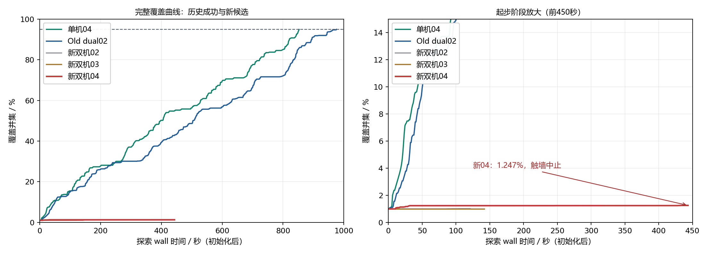

# Scene4拓扑协同交通预约与让行验证报告

日期：2026-11-16。**本轮4/4次试验已结束并关闭。新增交通预约、停稳后让行和本车观测补盲已接入，但没有达到覆盖并集95%，没有新的T95。第四次因车轮触墙安全中止，当前候选不满足“更快、更好且安全”的要求，不替换成功基线。**

## 1 同口径对照与本轮结果

沿用原Scene4世界文件和机器人／控制配置，2m/s控制限速、0.4m评分分辨率、12m观测范围、7790m²分母及7400.5m²阈值。每车使用原版独立评分库、各自观测及相同的同伴车体点过滤；两车格点集合去重取并集，不能相加面积。02—04独立评分CSV与运行集合均一致，真实程序／评分库及单一最终速度发布者检查通过。

初始化继续采用robot1的3.5m目标、robot2的1.2m目标与0.6m/s限速；得分不在初始化后清零。T95 wall从初始化完成后的统一探索信号计，到并集首次≥95%的实际单调时间；总运行wall还包含启动与清理，两者分别报告。

|配置|最终覆盖|T95 wall / 秒|T95 sim / 秒|探索总路程 / 米|
|---|---:|---:|---:|---:|
|single04|95.0531%|853.085|805.116|1212.650|
|Old dual02|95.5153%|976.358|701.047|1872.592|
|本轮最终双机04|1.2467%|未测得|未测得|17.315|

**无法计算新候选相对单机04／Old dual02的T95加速比。** 新04只探索了约1.25%，17.315m低路程反映没有持续探索出去，不能称节省路程。新04探索阶段持续444.144wall秒、342.088sim秒，总运行522.266wall秒后触墙；这个522.266秒不是T95，也不能与853.085／976.358秒直接当作完成用时比较。

|新增试验|总运行wall / 秒|最终并集覆盖|T95 wall|探索路程 / 米|结束原因|
|---|---:|---:|---|---:|---|
|01|20.661|—|未测得|0.000|启动时钟误触发限时守卫；未进入探索|
|02|199.953|1.0064%|未测得|0.193|诊断中止：无原生规划反馈／任务路线|
|03|219.306|0.9879%|未测得|0.043|诊断中止：原生五状态入口运行，但车体门控阻断|
|04|522.266|1.2467%|未测得|17.315|安全中止：robot1前左轮接触墙体|

01的0面积是未启动评分／探索时的结果初值，表中不把它当有效覆盖测量。四次均计入额度，含启动失败与中止，全部总wall≤2400秒；没有第五次、原生地图重放或额外复测。02／03为诊断提前中止，04为触墙中止，未用满2400秒；因此不存在“运行满2400秒的T95”记录。任务额度权威：TOPOLOGY_TRAFFIC_LIMITS_20261116.json，当前4/4 closed。

同一初始化目标不等于完全相同初始状态：新04的robot2探索起点x≈1.007m，Old dual02≈0.853m，相差约0.154m；新04的robot1 x≈3.156m，与对照接近。本轮是有限工程验证，不能作为单补丁消融、统计重复复现或归因某一种分配策略的论文比较。

图中01因未进入探索而不绘制。02／03／04曲线都远未接近95%线。右图放大起步阶段；曲线及CSV保存在topology_traffic_20261116，未以仿真时间替代wall时间。

## 2 本轮修改了什么、为什么修改

|部分|具体修改|原因及证据边界|
|---|---|---|
|短路径预约|读取实际执行器局部路径、请求速度和两车里程计，检查路径交叉和预测车体间隙|任务归属不保证通道互斥；已看到BRAKE／PASS／FREE切换，尚非完整狭窄会车验收|
|通行权交接|FREE→BRAKE要求本epoch、执行token对应的双车新鲜停稳／零速证明，之后才PASS；换赢家先重新BRAKE|不能只靠定时器把通行权交给另一车；日志有有效执行代次的双车让行证明|
|有限后退|中央只收reverse_ok摘要，真正后退由本车门控检查后方车体及0.15m余量全为已观测自由|未知／旧地图不授权；单次0.75m或4.5s，累计预算1.6m，速度-0.2m/s。本轮未在线触发RETREAT，不能称后退已验收|
|速度许可|与任务／执行代次绑定，0.3s失效，不能覆盖任务STOP和执行器失效保护；实际速度差分补足缺失twist|避免旧请求放行和漏算制动距离；沿用Old dual02的0.7×0.6m车体、2.5s预测和2m/s²／2rad/s²制动储备|
|等待反馈|合法HOLD暂停局部停滞计时，但同token累计20s仍请求重新规划，换epoch不无限续期|等待不能被误判为墙前停滞，也不能永久占住瓶颈。当前无执行租约的待命车不会直接后退|
|根节点可达挂接|入口必须有从本车根节点出发的已知自由路线，修正连接到孤立近邻原生节点的问题|离线两项反例验证“可达走廊不丢／真实隔墙不竞得”；03已经出现原生规划反馈，但02现场缺完整图，不能唯一归因02|
|停止后即时派发|有效停止证明到达、归属释放后立即发布就绪任务；修正快照缓存键被循环变量覆盖|减少空路径重试与0.5s定时派发竞争，不用伪造停车成功|
|本车执行图补盲|在地形图与本车真实UFO投影间合并观测：整细格四角明确Free才补未知，已知障碍优先|03保存的地形点离车身最近约1.587／1.619m，车身盲区被当未知；04有483条“terrain未知→combined自由”反馈并实际移动。远端地图仍未插入|
|实验与收尾|新有限额度、冻结脚本、初始化后切换执行协议、运行指纹与进程token；显式设置仿真时钟、回收子进程，最终停止前关闭探索请求生产者|01修正启动时钟竞态；02／03最终Action ACK失败仍保留，04最终双车ACK成功。只清理本轮拥有的进程，不终止发行版|

本轮沿用完美通信／共同world。车体预约与停车协议为本项目适配，几何来源固定于TRAFFIC_IMPORT.json中的Old dual02；不是C²-Explorer或GVP-MREP论文原算法。连通任务／图距离分配仍来自前阶段方案；此次没有新增跨机器人回环、受限通信、DTW聚类或MinPos／MDVRP全模式实现。**本车地形与UFO合并不等于重新启用跨车点云融合。**

## 3 离线与在线分别验证到哪里

|检查|结论|
|---|---|
|Python离线|首版52项、根挂接修复后54项，Windows／WSL通过|
|本轮C++|8项本车观测补盲／障碍／未知检查＋14项前缀／来源检查，ASan＋UBSan通过|
|隔离编译|新planner和最终Python叠加包成功；planner保留原有UFOMap歧义和C编译参数警告，没有改第三方代码|
|程序解析|旧catkin缓存指向旧planner的问题在04启动前被拦住；新环境与在线指纹均确认实际加载新planner／库，评分仍加载原版库|
|五状态|04日志中1／2／3／4／5均出现（状态2为2次）；只证明实际访问，不能代替全空间探索验收|
|路径执行|259条规划前缀接受，7条执行器接收反馈；实际探索路程17.315m，未完成整场景|
|交通|收到BRAKE 127、PASS 192、FREE 8536条状态消息；这些是采样消息数，不是事件次数或精确持续时间。12条让行停稳证明分布在4个epoch，含启动期；未观察RETREAT|
|最终停车|04双车Action停止ACK均成功，日志匹配本次final请求号、新鲜里程计及零速持续≥0.5s；2s停车观测位移约0.00000016／0.00008176m|
|安全|04无已记录车车接触，最小双车矩形间隙约0.484m；但发生车轮—墙接触，整体安全验收失败。该间隙不是与所有障碍的距离|
|评分|02—04独立源CSV／集合一致，04最大并集97.12m²；没有95%、原生全场完成或有效T95|

04接触对象为`robot_1/front_left_wheel_link`与`grey_wall_short_clone_1`。保存列表有100条同一对象对的重复接触记录，达到监测列表上限，**不能说发生了100次独立事故**。接触触发中止后，最终停车ACK成功并不抹去此前碰撞。

## 4 没有达到目标的原因与剩余问题

04共有798条原生规划反馈：259条接受、539条拒绝。其中307条是CURRENT_OCCUPIED，195条是TURN_BLOCKED，另有25条通用阻断、12条过期地图。前段本车观测补齐解除启动盲区，之后仍反复卡在近墙车体判定／转向。融合图点路径可达，不等于带方向的车体路径可执行；当前竞标和原生目标筛选尚未闭合这一差距。

交通多数采样处于FREE、两车后来相距较远，而覆盖仍停在约1.25%，说明本次停滞不能主要归咎于“互相让行一直不放行”。但路径拒绝之后频繁停止／重派没有解除近墙状态：04仍有662条STOP_REQUEST、665条任务STOPPED、6条EXECUTOR_STOP，没有EXECUTION_STALL或TRAFFIC_WAIT_REPLAN记录。不能因为有超时／停滞代码，就声称恢复机制在本次样本中已有效触发并解锁。

此次触墙还说明：计划前缀的静态车体检查与最终实际轨迹之间，缺少足够的跟踪误差／前向制动安全闭环。粗UFO占据投影与细地形图的尺度差异也可能加重保守阻断。**这些是需要继续定位的机制解释，不是已证明的唯一接触根因。** 当前保存的速度／位姿状态约1Hz，不能据此断言接触瞬间始终零速或精确归因某个控制器回调。

已知风险还包括：待命车没有专用合法让行任务时不能挪开；后退只有离线反例，无本轮在线窄道样本；跨来源任务可能重复、负载可能不均；精确图关联可能漏连。UFO投影Free在本Scene4平地可用于空间证据，不能直接推广为四足坑洞／起伏地面的地面支撑证明。

下一步应先离线定位近墙目标／方向可执行性、粗细观测一致性与控制跟踪边界，并让“规划持续BLOCKED”有真正的恢复入口，避免靠换任务版本重置过程。再考虑待命挪位与窄道后退的独立验收。**本轮已关闭，不再修改算法、启动第五次或原生重放；后续运行需要新的明确有限授权。**

## 5 代码与证据入口

- [traffic.py](https://github.com/y-ii-ii/STGPlanner-reproduction/blob/b505e98/multi_robot/team_topology/src/team_topology/traffic.py)：预约状态机、本车让行证明与后退证据门控。
- [topology_traffic.py](https://github.com/y-ii-ii/STGPlanner-reproduction/blob/b505e98/multi_robot/team_topology/scripts/topology_traffic.py)：交通ROS适配，读取路径／里程计／速度，发带代次许可；无点云、格图或Gazebo真值订阅。
- [topology_velocity_gate.py](https://github.com/y-ii-ii/STGPlanner-reproduction/blob/b505e98/multi_robot/team_topology/scripts/topology_velocity_gate.py)：最终速度许可组合和停稳证明。
- [exporter.py](https://github.com/y-ii-ii/STGPlanner-reproduction/blob/b505e98/multi_robot/team_topology/src/team_topology/exporter.py)、[topology_coordinator.py](https://github.com/y-ii-ii/STGPlanner-reproduction/blob/b505e98/multi_robot/team_topology/scripts/topology_coordinator.py)：根可达挂接、缓存、停止后派发。
- [own_observation_union.h](https://github.com/y-ii-ii/STGPlanner-reproduction/blob/b505e98/multi_robot/native_overlay/planner/include/rapid_cover_planner/own_observation_union.h)、[topology_bridge.cpp](https://github.com/y-ii-ii/STGPlanner-reproduction/blob/b505e98/multi_robot/native_overlay/planner/src/topo_planner/topology_bridge.cpp)：本车观测补盲及判定诊断；障碍不清除。
- [bench/run.py](https://github.com/y-ii-ii/STGPlanner-reproduction/blob/b505e98/multi_robot/bench/run.py)、[bench/prepare.py](https://github.com/y-ii-ii/STGPlanner-reproduction/blob/b505e98/multi_robot/bench/prepare.py)：新有限额度实验、评分、初始化、指纹、清理与停车；不能运行旧run.py来替代。
- [build_traffic_offline.sh](https://github.com/y-ii-ii/STGPlanner-reproduction/blob/b505e98/multi_robot/build_traffic_offline.sh)：只针对新候选工作空间。旧build_native_task_offline.sh指向受保护前阶段空间，本轮不得用它覆盖重编译。

|提交|修改与原因|
|---|---|
|db282e8|预约、停稳后让行、有限后退及新实验入口，补新拓扑候选缺失的交通层|
|fd5c054|修正01的仿真时钟初始化竞态，回收已退出启动器|
|85dc4a7|ROS时间等待卡住时也在wall上限内结束监督器|
|07916ce|修正孤立近邻挂接、缓存键及ACK后派发，补充诊断存档|
|b505e98|本车观测补盲、新隔离planner／环境指纹、最终停车前关闭请求生产者|

各逻辑提交已推送用户允许的公开[feat/multi-robot-topology分支](https://github.com/y-ii-ii/STGPlanner-reproduction/tree/feat/multi-robot-topology)，正文记录what／why／验证和限制；main与历史标签未改。结果与报告作为后续文档提交，不修改已测试算法。

## 6 保全与交接

最终核验：172个原保护文件SHA256、12823个原历史文件清单／大小／mtime未变；269项新旧WSL源／配置／程序指纹匹配；旧原生任务阶段101个源码／配置和6个程序／库不变，首阶段70源码／2二进制也保留。4次新结果990个文件生成SHA256清单，28份执行程序归档逐项核验。主Git工作树干净，原单机04／Old dual02仍为选用对照，新候选未晋升基线。

原始目录：`benchmarks/results/topology_traffic_scene4_20261116_01_dual`至`04_dual`。本机证据／冻结脚本／二进制归档：`codex/work/topology_traffic_20261116`。公开精简证据：`multi_robot/evidence/traffic_scene4_20261116`，不上传巨型原始ROS日志或二进制。

清理后ROS／Gazebo活动进程0，11311／11312／11345端口空闲；锁idle，额度4/4 closed。最终结论仍是：**停止ACK与起步执行有所改善，双车持续、安全、高覆盖探索及T95效率目标未达成。**
