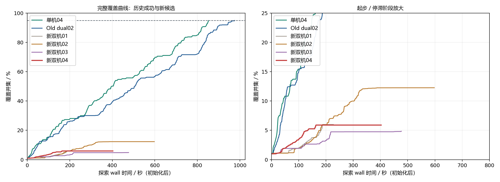
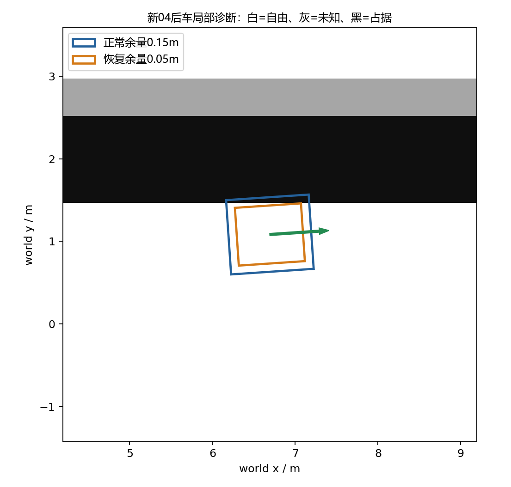
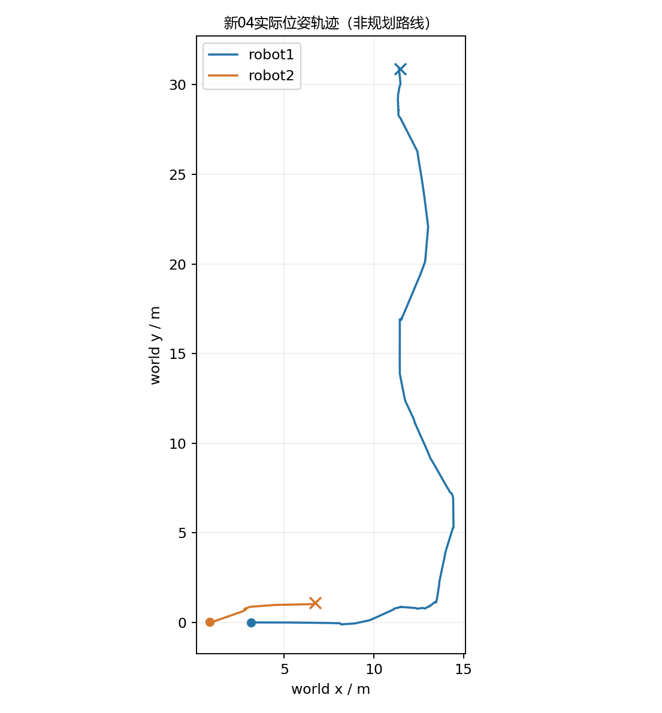

# 结论

本轮4/4次已完成并关闭，**持续探索验收未通过**。四次均未达到两车覆盖并集95%，所以没有新的有效T95，不能证明比单机04或Old dual02更快、更好。候选不晋升，成功单／双机基线继续保留选用。

本轮改善了部分近墙执行问题：四次均未记录非地面接触，最终双车停止ACK均通过；已见低速退离、恢复正常路线、短前缀执行和长期拓扑连接保留。但这些局部机制通过，没有转化成全空间探索效率。最后配置仅覆盖**459.20m²／5.895%**，因240秒无覆盖增长收尾。最佳面积是第2次的955.36m²／12.264%，也远未达到95%。

# 条件和计分口径

- 同一Scene4世界、Jackal模型和底盘控制配置；每次初始化后开始探索计时。两车起步目标仍为(3.5,0)/(1.2,0)，初始化速度上限0.6m/s。
- 最大平移速度保持2m/s；独立原版评分器、0.4m评分格、12m范围、7790m²分母保持。并集按来源评分格ID去重，**面积=0.16×|U1∪U2|，95%阈值=7400.5m²**。四次独立CSV并集均与结果一致，未把协同规划地图当评分地图。
- 完美通信、共同world、真值定位仍为前提。共享拓扑／任务／交通状态，不向另一车插入点云或占据图；细地图与UFO观测组合只发生在本车。
- **同速度的范围是相同2m/s平移上限，不是所有控制律完全相同。** 本轮替换局部路径跟踪：原FALCO参数转向上限60°/s，新跟踪原地转向限0.7rad/s、运动跟踪限1rad/s，恢复另限0.2m/s和0.3rad/s。因此这不是固定全部角速度／加速度的纯分配消融，不能把全部耗时差异归于分配算法。
- 每次总wall含启动、初始化、探索和收尾≤2400秒，启动失败／中止计数。T95 wall只从探索开始到首次达到95%，与“总wall”不同。本轮没有用停止时的wall冒充T95。

# 四次结果与历史对照

| 配置 | 最终并集覆盖 | 总wall秒（含启动收尾） | 探索wall秒 | 截止停止的总路程米 | T95 wall | 结束原因 |
|---|---:|---:|---:|---:|---|---|
| 新双机01 | 5.995% | 307.241 | 227.499 | 51.459 | 未达到 | 诊断中止 |
| 新双机02 | 12.264% | 679.335 | 597.768 | 104.145 | 未达到 | 诊断中止 |
| 新双机03 | 4.837% | 559.246 | 477.735 | 79.058 | 未达到 | 诊断中止 |
| 新双机04 | 5.895% | 484.159 | 403.276 | 49.662 | 未达到 | 覆盖停滞240秒 |

四次均为双车。前三次为明确计入额度的诊断中止，第4次由既定停滞守卫结束。四次无非地面接触，双车最终nonce停止ACK均通过；这是有限已行驶轨迹上的证据，不能外推全Scene4安全性。消息条数、状态采样数与独立事件次数在下文分开表述。

| 成功历史配置 | T95 wall秒 | T95 sim秒 | 到95%的总路程米 |
|---|---:|---:|---:|
| 单机04 | 853.085 | 805.116 | 1212.650 |
| Old dual02（双车） | 976.358 | 701.047 | 1872.592 |

新候选没有达到相同终点，**49.662米不代表比1872.592米更省，484.159秒也不代表比976.358秒更快**。新候选只是提前停滞。作为同时间证据，取各曲线200秒前最近的样本：

| 配置 | 实际样本wall秒 | 覆盖并集 |
|---|---:|---:|
| 单机04 | 199.300 | 27.582% |
| Old dual02 | 199.635 | 26.087% |
| 新01 | 199.692 | 5.995% |
| 新02 | 199.855 | 5.958% |
| 新03 | 199.480 | 3.292% |
| 新04 | 199.318 | 5.895% |

这也显示当前新闭环整体效率明显低于成功对照；本轮每次配置有变，不是重复统计复现。

# 修改了什么、为什么

保留原STG建图和五状态局部选点，并继续施加连通任务范围约束；本轮主要改路径可执行性和执行端。**路径执行已增加新的车身跟踪层，不能再称完全沿用原FALCO执行方式。**

| 部位 | 修改前问题 | 本轮最终修改 | 证据与边界 |
|---|---|---|---|
| `body_route.h`／`topology_bridge.cpp` | 点路径、近墙前沿终点可选，但车身转向／停靠不可行 | 朝向随实测车头旋转的SE(2)局部格点搜索；逐段矩形扫掠；距参考点0.8m内选择自由接近点；必要时执行≤4m已知自由短前缀 | 新04有67条前缀规划接受消息；这不等于全部被物理执行。未知/占据仍阻断，未标记完成 |
| `path_execution` | 1m前瞻点可裁掉原地转向／倒车约束 | 保留完整朝向路径；认证消息绑定会话、任务版本、dispatch、goal_seq | 新执行器解析及实际运行二进制校验通过；正常／恢复路径通过同一租约 |
| `body_tracking.py`／最终速度门控 | 把旧规划首位姿当新目标，造成小角度纠正和倒车；交通许可可以覆盖当前建议 | 顺序跟踪，只合并同方向共线段；测量锚点不要求转回旧朝向；偏离起点时停车重规划；交通放行之后再次检查车身与制动扫掠 | 新01有124条“cursor=0请求倒车且实测仍前进”的采样，新04为0；只说明该特征在本次未再观察到，不能代表所有振荡消失 |
| 近墙恢复 | 正常0.15m安全余量失效后反复拒绝，无可执行恢复入口 | 显式`BODY_RECENTER`证书：实际车身＋0.05m必须已知自由；短恢复搜索代价≤1、平移≤1m，终点恢复正常0.15m余量；最终输出限0.2m/s、0.3rad/s | 新03有6个恢复token，110条恢复采样；新04有1个token、67条采样，并观察到移动约0.125m后恢复正常跟踪。恢复速度越界采样为0；后车仍有82条BODY_NO_PATH拒绝 |
| `navigation_history.py`／导出器 | 局部图更新会删除曾用连接，后车无法访问前车新任务 | 按来源保留已验证路径段；本车新地图中变占据／未知的段立即剔除；压缩度2节点，保留分支和环的路径采样 | 新03实测时两车根可达样本均为640；新04末两车均有16个图上可达任务。没有跨车点云融合，也没有实现DTW或SLAM回环 |
| 协调与诊断 | 2秒阻断重试、旧起点、停滞不断被重置，原因难区分 | 阻断暂缓15秒；新增实际路径、较高频率位姿/输出、完整交通日志及分配等待诊断 | 最终仍出现“有任务，但反复STOP/ACK”的闭环问题，未宣称已解决 |

正常检查采用车身0.7×0.6m及0.15m余量。恢复是明确的局部例外，不能穿越任何占据／未知，也不按机器人位置制造自由空间。制动模型包含0.15s延迟和0.25s指令保持，两轴按2的制动假设检查；加速按可立即到达请求速度估计。这些参数没有经过独立制动标定，有限无接触结果不等于形式安全证明。

# 为什么仍然不能持续探索

**第一，近墙恢复仍有真实几何阻断。** 新04后车样本中，实际车身＋0.05m在本车细栅格为自由，而＋0.10/0.15m均相交占据。当前短恢复没有找到恢复正常余量的路线。与墙近似平行时，先旋转会扫墙，1m恢复约束可能不足；不能把“没找到”直接当成“环境不存在安全路线”。此处没有清空墙体或强行前进。

**第二，停止确认通过，但派发活性没有通过。** 新04最后分配诊断显示：16个有效任务组，候选数robot1=15、robot2=1，两车各有16个图上可达任务，期望均为ROUTE；实际却都在stopping。robot1本车样本甚至具备0.20m余量，仍未持续执行。新04共有510条STOP_REQUEST和513条STOPPED消息，不能把它们当独立故障或成功交接次数。

代码上，`ExecutionSupervisor.commands()`在任一活动机器人停机过渡时阻止其他新派发，空规划结果又会经`ControlPlannerInterface`触发新的停止请求／nonce。验收使用**现有纯Python状态机**构造了合法时序，连续6轮使另一台已准备好的独立任务得不到ROUTE，证明协议缺少活性保证。该反例没有启动ROS/Gazebo或原生重放，也不声称完全重建了线上消息顺序。详细见`STOP_CHURN_COUNTEREXAMPLE.json`。

**第三，双车仍未形成有效并行贡献。** 新04评分：robot1=459.04m²、robot2=83.20m²、并集459.20m²。后车独有贡献仅0.16m²，即1个评分格，不具有显著效率意义。图上可达不等于车身可执行，也不保证进入不同分支。

本轮最后原生五状态访问计数为{'1': 723, '3': 584, '4': 781, '5': 661, '2': 1}；入口有被访问，但没有形成全空间持续探索。最后没有纯`EXECUTION_STALL`事件，主要是EXECUTOR_STOP和空路径停止往返，停止重试仍可能提前重置停滞计时。通信方面，新04拓扑应用消息累计21,502,546字节，命令7,110,551字节、反馈1,503,914字节；这是单次ROS String应用计数，不含传输开销、扇出或其他通道，也未与旧点云方案做同口径通信量对照，不能据此宣称通信效率已提高。

# 离线验收、保全与GitHub

- 76项Python测试通过，包括租约/停止证明、交通门控、环路保留、旧桥失效和含惯性的L型走廊跟踪；33项ASan/UBSan C++检查通过。另有已落盘受阻栅格的独立恢复几何单测，未启动原生ROS规划器或地图重放。
- 独立planner/executor/Python空间已编译；首次完整编译有既有UFO overload警告，最终增量编译成功、无新增警告。367项WSL源码/配置指纹匹配，其中269项旧指纹不变；实际规划器／执行器／原版评分库与运行图隔离检查通过。 四次分别96/96/98/98项构建源码与配置的归档原始SHA一致，且与各自Git提交逐文件原始字节一致，见`SOURCE_GIT_AUDIT.json`。
- 173项保护文件SHA、12823项原历史文件清单/大小/mtime、990项上轮原始文件SHA均一致。本轮1157项原始文件已全量SHA，旧28份与新28份执行程序归档均核验。主Git干净、原基线选用清单未变，所有旧scope额度未变。
- 四次均≤2400秒，最终双车停车ACK通过；新04两秒停车漂移约0.000081/0.000647m。当前ROS/Gazebo与11311/11312/11345均空闲。新额度4/4 closed，不启动第五次，不继续改算法。

代码分支`feat/multi-robot-topology`，未合并或替换成功基线。四个逻辑代码提交均含“修改什么／为什么／验证”和代码注释，并已上传公开仓库：

1. [5d2cced：车身路径、最终制动门控、独立新试验栈](https://github.com/y-ii-ii/STGPlanner-reproduction/commit/5d2cced432a2a25feba0c89cca5fb9a2fbd1cbd4)
2. [aeac84c：滚动起点与统一安全余量](https://github.com/y-ii-ii/STGPlanner-reproduction/commit/aeac84c33131e3f5daa9d277e241cb9ff5fb69ea)
3. [7b28d6e：低速退离与导航历史保留](https://github.com/y-ii-ii/STGPlanner-reproduction/commit/7b28d6e8f3a647a8d267033387f80a94ecebbe71)
4. [80f0805：消除强制首转、自由短前缀、等待诊断](https://github.com/y-ii-ii/STGPlanner-reproduction/commit/80f08051f8b1bc2e8519788637c64f81caa93ae4)

原始数据：`D:/STGPlanner/benchmarks/results/topology_wall_scene4_20261117_01_dual`至`04_dual`；工作/保全证据：`D:/STGPlanner/codex/work/topology_wall_20261117`；Git可审查摘要：`multi_robot/evidence/wall_scene4_20261117`。收据：`D:/STGPlanner/codex/TOPOLOGY_WALL_COMPLETION_20261117.json`。

# 后续应先修什么（本轮不实施）

优先把空闲停止重试与真正的执行中止／同任务交接分开，合并重复请求，并用状态机活性反例验证；保留新请求后的真实停车证明。再把“车身可执行入口/恢复代价”纳入竞标，检查平行墙体的分段退离，不能只以点栅格图距离判可达。闭环稳定后，固定角速度／加速度和完整控制配置再做同场景95%／T95对照。任何新仿真需另有明确有限授权，本轮不自动推进。

本轮车身搜索、跟踪、制动与历史压缩为项目工程适配；保留既有STG五状态、C²式连通任务和GVP-MREP启发的图距离分配，不声称复现论文完整算法或实现DTW/跨车回环。
