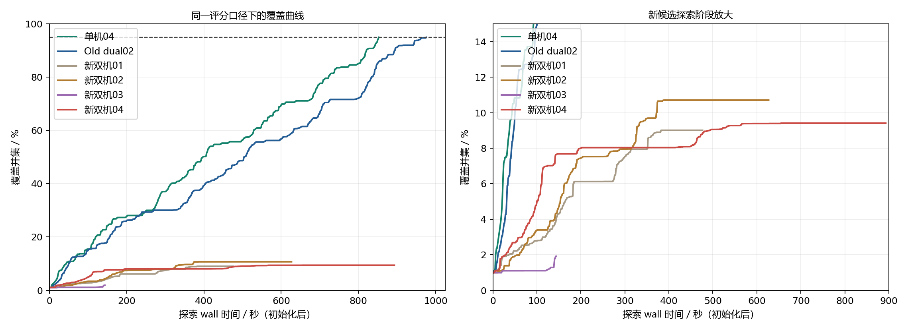
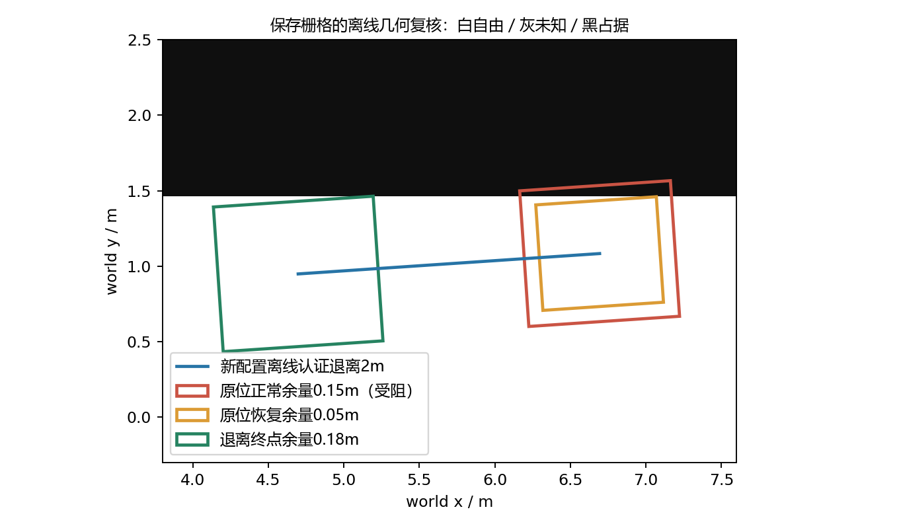
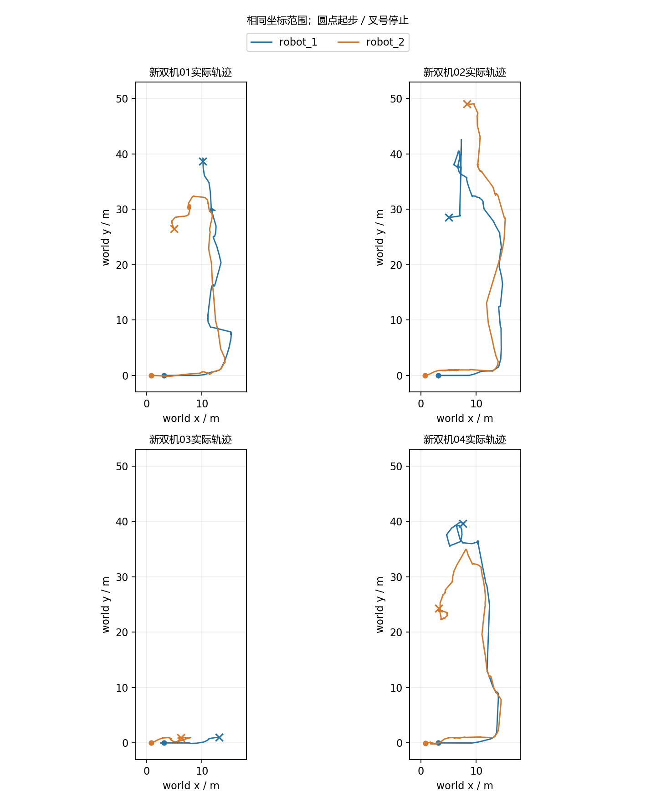

# 结论

本轮4/4已结束并关闭，**四次均未达到两车覆盖并集95%，没有新的有效T95**，目前不能证明比单机04或Old dual02更快、更好。成功单／双机基线继续保留选用，新候选不晋升。 本轮最高覆盖来自第2次：834.08m²／10.707%。

本轮补了重复STOP与派发干扰、在途ACK交付、有限超时重试、近墙较长退离、终点朝向验收和反馈优先处理。**修复代码存在、离线检查通过，不等于持续探索验收通过。** 第3次还发生原生规划器SIGSEGV，并因原栈退出造成最终停车ACK失败，完整保留，没有用“车已静止”替代停车证明。

最后一次：**覆盖732.96m²／9.409%、探索wall 893.919s、含启动收尾总wall 974.641s、总路程166.803m**；结束原因`coverage_stagnation_240wall`。T95 wall：未达到。最终ACK：{'robot_1': True, 'robot_2': True}。这些数值不混为同一个指标。

# 条件、计分和次数

- 四次都是真正双车，完美通信、共同world坐标系、仿真真值定位。同一Scene4世界、Jackal模型、底盘配置及原版评分器；世界、URDF、控制与评分配置指纹均对照历史Old dual02核验。
- 普通最大平移2m/s、转向60°/s；恢复仍限0.2m/s和0.3rad/s。**速度上限一致，跟踪控制律已有变化**，不是固定全部控制细节的纯任务分配消融。初始化目标(3.5,0)/(1.2,0)，初始化限速0.6m/s；实际初始化停靠误差记录在各result中。
- 评分格0.4m、范围12m、分母7790m²；两车各自原版评分格按ID去重：`A=0.16×|U1∪U2|`，95%阈值7400.5m²。评分独立于共享规划拓扑。每次CSV来源并集与result核验，未把重叠面积重复计入。
- T95 wall是初始化验收后“开始探索”到首次达到95%的实际耗时。总wall还包含启动、初始化和收尾。未到95%时T95为空，不能拿中止wall当作速度成绩；未完成时的短路程也不是到95%的节省。
- 权威`TOPOLOGY_DISPATCH_LIMITS_20261117.json`：最多4次、每次含启动收尾wall/sim≤2400秒。启动失败、中止和崩溃也计数。01—04均计入；没有第五次、补跑或额外原生地图重放。用户中途“额度恢复”没有重置实验次数。

# 结果及成功对照

| 配置 | 最终覆盖并集 | 总wall s | 探索wall s | 截止停止总路程 m | T95 wall s | 结束原因 | 最终双车ACK |
|---|---:|---:|---:|---:|---|---|---|
| 新双机01 | 9.008% | 562.901 | 476.795 | 133.735 | 未达到 | 诊断中止 | 通过 |
| 新双机02 | 10.707% | 709.889 | 627.278 | 172.718 | 未达到 | 覆盖停滞240秒 | 通过 |
| 新双机03 | 1.920% | 234.186 | 144.180 | 30.749 | 未达到 | launch_exit:[('stack', 0)] | 失败 |
| 新双机04 | 9.409% | 974.641 | 893.919 | 166.803 | 未达到 | 覆盖停滞240秒 | 通过 |

四次配置逐步改变，不是四次独立同配置统计重复。接触记录以Gazebo独立监视器为准，结果和原始接触日志都保留；有限已行驶轨迹无接触不能证明全Scene4无接触。

| 历史成功配置 | T95 wall s | T95 sim s | 到95%总路程 m |
|---|---:|---:|---:|
| 单机04 | 853.085 | 805.116 | 1212.650 |
| Old dual02（双车） | 976.358 | 701.047 | 1872.592 |

两项历史原始结果、选用配置及二进制保持。本轮若未达同一95%终点，就没有有效“比单机04／Old dual02快多少、少走多少”的结果。下面另列120秒前最近一次样本，样本时间逐项列出，只有运行满120秒的曲线参与，避免将不同停止时刻当作同时间对照：

| 配置 | 实际样本wall s | 覆盖并集 | 累计路程 m |
|---|---:|---:|---:|
| 单机04 | 119.911 | 20.126% | 173.473 |
| Old dual02 | 119.115 | 15.702% | 241.448 |
| 新双机01 | 119.936 | 3.054% | 55.633 |
| 新双机02 | 119.701 | 3.395% | 50.470 |
| 新双机03 | 119.939 | 1.103% | 22.965 |
| 新双机04 | 119.497 | 6.975% | 67.531 |

# 修改了什么、为什么

| 部位 | 先前问题 | 本轮修改 | 验收边界 |
|---|---|---|---|
| PCI／Explorer | WAIT、BLOCKED等空结果重复停车，可能取消刚获得ACK的新派发；移除RPC后又可能忙轮询 | 拓扑模式空结果不再另发停车RPC，改由任务租约和门控控制；空结果退避0.15秒 | 显式结束、失败、超时仍停车；不是让空结果继续任意运动 |
| ExecutionSupervisor | 任一车正在停车会挡住所有新派发；重复同请求重置空闲STOP | 按任务成员或未知支撑重叠等待旧拥有者，独立任务可派发；同ID幂等 | 相同/别名任务仍必须等旧车停车；物理路径交叉仍由交通预约约束 |
| 原生StopProofCache | 新ROUTE可能清掉已产生但RPC还没取走的证明；延迟旧ACK也可能被误认新证明 | 区分在途交付与重传资格；按STOP nonce绑定运动epoch，运动后旧证明不再可重传；核对请求时间 | 新请求ID仍需新鲜证明；不把规划ACCEPTED当停车ACK |
| 停车反馈与超时 | 单次证明投递不稳，超时后永久fault；无位移执行结束后立刻重派 | 当前STOP/新鲜里程计/持续停稳/零输出下每0.75秒可重发；运行实例最多一次换新nonce重试；固定派发起点，无位移EXECUTOR_STOP冷却15秒 | 不接受过期nonce、不无限重试，不将冷却任务标为完成 |
| 协调回调 | 多线程持同一锁进行图应用和分配，ACK处理可能被繁忙数据流拖延 | 单状态拥有者、优先STOP事件、分批图更新、wall调度；增加排队/规划耗时和ACK接受拒绝诊断 | ACK饥饿是前两次证据指向的归因；是否长期解决要看在线数据，不凭离线队列测试下结论 |
| bodyRoute | 旧加权代价1只允许约0.67m倒退，近似平行墙退不出去 | 分别限制实际弧长≤3m、加权代价≤6；优先认证直退/原地转向，随后SE(2)搜索 | 全程车身＋0.05m必须已知自由，终点要求0.18m余量；没有清墙、占据变自由或穿未知 |
| 执行终点／跟踪 | 零位移转向因位置已到就宣布完成；恢复结束误差又使正常余量失效 | 恢复同时核对8mm位置和0.02rad朝向，跟踪终点容差更小；正常角速度/角向制动参数与对照上限对齐 | 0.18m终点余量为正常0.15m和误差留缓冲，离线模型不是底盘制动标定 |
| 执行目标时间 | 记录到目标头比接收进程ROS时钟快1ms，被当成非法未来目标 | 只对目标头允许≤20ms投递偏差 | 租约/代次/当前STOP仍核对；超过2s过期、20ms未来、非有限值拒绝 |
| 栈退出后的停车 | 第3次required planner崩溃连带杀掉里程计，无法收集新鲜ACK | planner退出不再触发整栈kill；监督器绑定六个原生PID及启动时间，退出/僵尸/PID重用即失败；增加best-effort致命栈输出 | 不掩盖崩溃、不自动续航；没有修复或宣称找到SIGSEGV根因 |

相关文件：`execution.py`、`inbox.py`、`topology_coordinator.py`、`control_planner_interface.cpp`、`explorer.cpp`、`stop_proof_cache.h`、`topology_execution.cpp`、`execution_endpoint.h`、`execution_clock.h`、`body_route.h`、`body_tracking.py`、`runtime_health.py`及bench准备/运行器，均有对应注释。详细逐次说明见仓库`multi_robot/docs/DISPATCH_RECOVERY_20261117.md`。

共享拓扑、连通任务和图距离分配保持，原STG五状态任务约束保持。本轮没有新实现DTW、跨机器人SLAM回环或受限通信论文算法，不能把这次STOP/ACK工程修复说成那些方法的论文复现。

# 数据能证明什么，不能证明什么

**近墙恢复离线证据。** 使用上轮04已保存的后车栅格，不启动ROS/Gazebo、不重放原生地图。新几何搜索找到2m直线退离，终点满足0.18m；合成跟踪11.5虚拟秒、231采样、速度/扫掠检查通过，结束恢复正常0.15m余量。说明旧0.67m预算确实会漏掉这一条安全恢复路径，不能说明任意墙角都可脱困。

**STOP证明存在与被协调端确认是两件事。** 第1次末次fault nonce各只有1条可见证明；第2次重发已生效，末次nonce各有284/313条证明，且进入fault前各已出现8条，首条约0.6秒到达独立记录器。因未记录旧协调端每次处理时刻，不能断言每条都被其收到或断言唯一根因是互斥锁。第3次优先队列短程运行最大排队38.2ms、规划32.3ms、ACK接受8条、重试0；随后原生崩溃，不是完整95%验收。

最后一次协调诊断：最大反馈排队`0.4722810180101078`秒，最大规划`0.39913462700496893`秒；ACK接受消息`617`条；最后协调阶段`{'1': 'running', '2': 'stopped'}`，STOP重试计数`{'1': 0, '2': 0}`。重复已确认或旧nonce证明被拒绝是正常行为，拒绝消息总数不等于停车失败次数。详见`ACK_TIMELINE.json`和`MECHANISM_AUDIT.json`。

**高层重派循环仍未修好。** 新04 robot1最后628.657秒的位姿样本始终位于最终位置0.1m圆盘内，却收到了77个不同任务、289个派发代次和288个STOP nonce。固定单任务ID的15秒冷却无法充分约束跨任务ID的循环；本轮不把“ACK变多”说成“探索闭环已修复”。这些是记录器收到的命令数，不等于全部执行。

**图更新新鲜性仍失败。** 最后一次851条约1秒状态样本中有227条为`stale_source_state`；最多10个图包等待处理，源状态年龄分别最高{'1': 3.4390000000003056, '2': 3.4169999999994616}秒。共享拓扑应用层接收量截至最后探索样本约191.85MB，含重复/增量/全量修复消息；不含TCP开销和广播扇出，不是无线硬件流量。完美通信并不免除计算/队列负载。新优先队列本次没有进入STOP fault，但源状态过期导致频繁WAIT/停车，仍阻断持续探索；没有为追求覆盖放宽新鲜性门槛。

**双车观测重叠仍大。** 最后robot1/robot2各自评分面积为625.76/703.52m²，重叠596.32m²，并集732.96m²。相对覆盖较大的单辆，本次另一辆只额外增加29.44m²；这是本次双车数据内的边际观测贡献，不能替代与完整历史单机95%实验的比较。

**仍有任务不代表任务可执行。** 全局图上可达只是路径连通条件；本车细地图、车身转向余量、执行租约和交通门控仍可能阻断。两车任务支撑重叠时，一车会等待另一车；图分区也不能保证两条路线物理分离。本轮实际轨迹仍用于检查跟随、退让和重复探索，不能仅靠“派发成功”宣布协同有效。

最后一次逐采样检查：非running输出运动样本`0`、过期地图输出运动样本`0`、恢复速度越界样本`0`。这些是落盘采样检查，不是连续时间形式安全证明。第3次最终ACK失败仍是未通过项，不以小停车漂移掩盖。

新04有19个带恢复证书的任务token、781条恢复跟踪采样；不能把token或重复采样条数当作独立脱困成功次数。普通输出最大2.000m/s、实测最大约2.015m/s，限速指令与底盘瞬态速度有区别。2m长退离的成功证据目前是前述离线保存地图/合成跟踪，未宣称在线在同一原卡墙位置完成了2m退离。

# 离线检查、保全与代码上传

最终**99项Python、57项C++ ASan/UBSan**检查通过；独立dispatch_native/dispatch Python空间编译和实际节点解析通过。没有替换旧成功空间，也没有对TARE/FAEL/GBP2进行新增测试。每次新源副本、实际执行程序和冻结配置都独立归档：

| 新试验 | 对应Git提交 | 原生/部署源码配置指纹数 | 执行程序/库归档数 |
|---|---|---:|---:|
| 01 | [6e845f2](https://github.com/y-ii-ii/STGPlanner-reproduction/commit/6e845f2263da6f267e33ad3a8eaf91e0e4d05624) | 121 | 9 |
| 02 | [9fc6c7f](https://github.com/y-ii-ii/STGPlanner-reproduction/commit/9fc6c7fa82caaf4fae3ecd208128abf3018d5041) | 122 | 9 |
| 03 | [91f5d6b](https://github.com/y-ii-ii/STGPlanner-reproduction/commit/91f5d6b26002ecb6ee732ecd10cd88572297a919) | 125 | 9 |
| 04 | [687e867](https://github.com/y-ii-ii/STGPlanner-reproduction/commit/687e867334f26ebf9a83b9e4d81a106f099a56fd) | 127 | 9 |

最终指纹核验498项（含371项既有保护）；177个保护文件、12823个历史文件元数据、990个交通原始文件及1157个上一轮近墙原始文件SHA保持；1221个本轮原始文件SHA落盘，旧程序归档56份、本轮36份均核对。逐次编译源码与归档按原始字节SHA核对；与Git仅允许CRLF/LF行尾差别，见`SOURCE_GIT_AUDIT.json`。

公开仓库：[feat/multi-robot-topology](https://github.com/y-ii-ii/STGPlanner-reproduction/tree/feat/multi-robot-topology)。每次代码提交均写明修改和原因；证据与本报告同步放在`multi_robot/evidence/dispatch_scene4_20261117`。原主Git和成功基线选用不变。

本轮已4/4关闭，ROS/Gazebo与11311/11312/11345空闲。后续只保全、报告、恢复已测试配置；不启动第五次或自动补跑，不继续改算法。下一步需要先依据本轮最后诊断处理尚存的原生稳定性、任务可执行性和交通效率，再由用户明确新有限试验授权；本报告不视为下一轮授权。

原始结果：`D:/STGPlanner/benchmarks/results/topology_dispatch_scene4_20261117_01_dual`至`04_dual`；本轮审计：`D:/STGPlanner/codex/work/topology_dispatch_20261117`。保全收据：`TOPOLOGY_DISPATCH_COMPLETION_20261117.json`。
